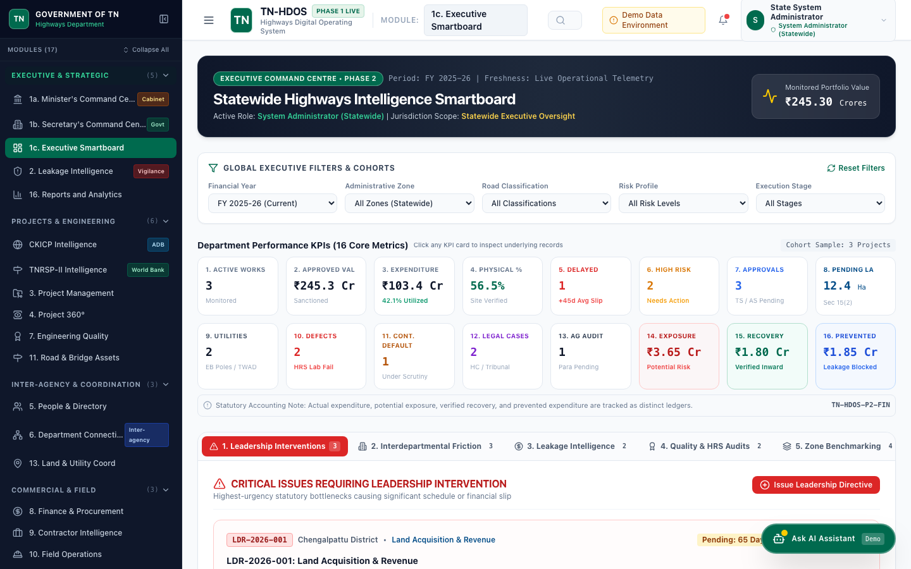
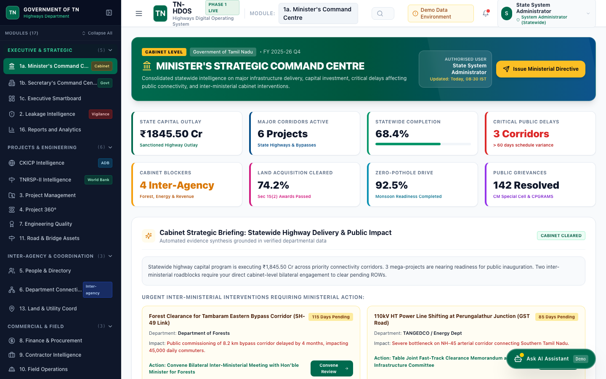
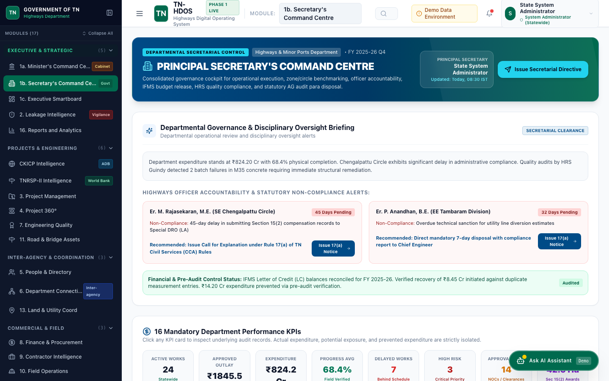
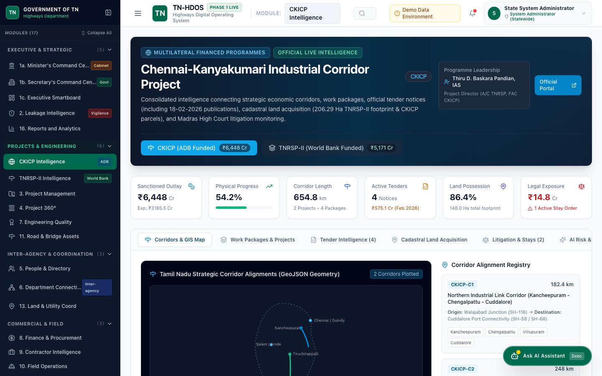
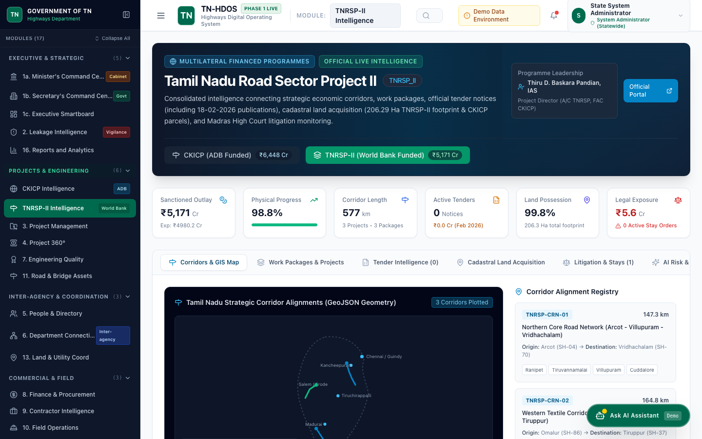
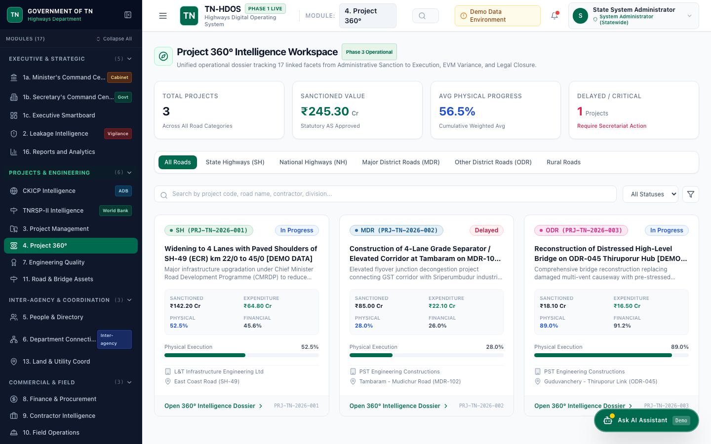
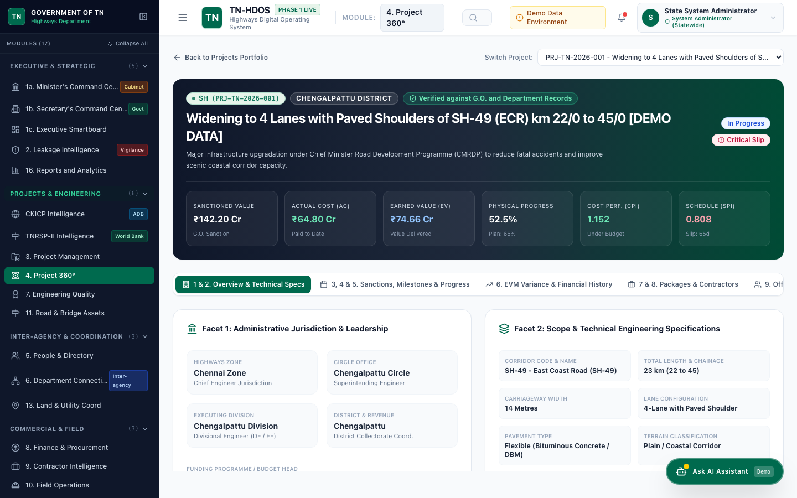
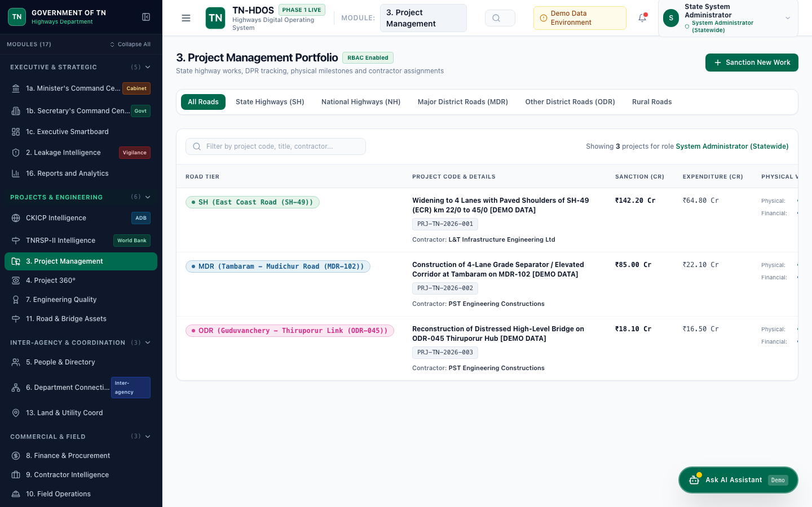
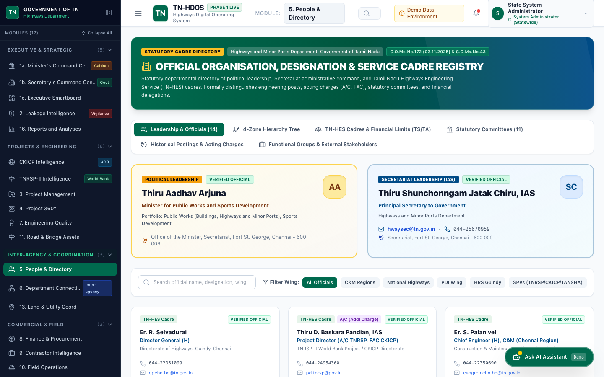
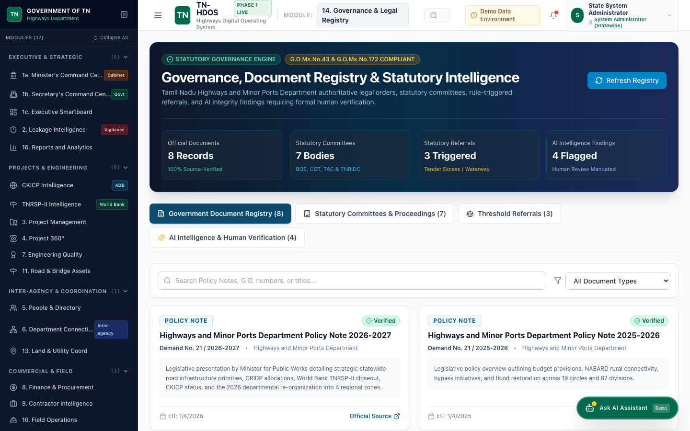

# TN-HDOS: Tamil Nadu Highways Digital Operating System

<div align="center">

[](https://www.tn.gov.in)
[](https://www.tnhighways.gov.in)
[](https://kiru6006.github.io/govt-highways-agent/)
[-006A4E?style=for-the-badge)](docs/TESTING_AND_VERIFICATION.md)
[](docs/PHASE_17_AUDIT_REPORT.md)

### An Integrated Enterprise Operating Platform for Statewide Infrastructure Governance, Project Intelligence, Inter-Agency Coordination & Decision Support

**Official Portal**: [https://kiru6006.github.io/govt-highways-agent/](https://kiru6006.github.io/govt-highways-agent/)

</div>

---

## 🏛️ Executive Overview

The **Tamil Nadu Highways Digital Operating System (TN-HDOS)** is the mission-critical digital operating platform developed for the **Highways and Minor Ports Department, Government of Tamil Nadu**.

Spanning over **73,000+ kilometres** of road infrastructure across 4 Administrative C&M Zones, 8 Specialized Wings, 40+ Circles, and 100+ Divisions, TN-HDOS transitions departmental administration from physical file dockets, disparate spreadsheets, and delayed reporting into a single, connected, and auditable digital intelligence console.

### Key Questions Answered for Departmental Leadership:
* **Hon'ble Minister**: Which flagship projects are delayed? What are the constituency-level delivery dates? Are there public grievances or inauguration-ready assets?
* **Principal Secretary**: Where are inter-departmental clearances (Revenue, TANGEDCO, Forest, Southern Railway) blocked? What is the budget expenditure (BE/RE) run-rate? Which contractors are lagging?
* **Director General & Chief Engineers**: What is the root cause of project delay? Is it Land Acquisition (LA), utility shifting, or contractor cash-flow? What statutory committee approvals are due?
* **Superintending & Divisional Engineers**: What is the Earned Value ($EV, PV, AC$) variance on my division's packages? Are quality test cube results compliant with MORTH specifications?

---

## 🚀 Active & Completed Operational Workspaces

TN-HDOS delivers connected operational workspaces designed specifically for the hierarchy of the Tamil Nadu Highways Department:

```
┌───────────────────────────────────────────────────────────────────────────────────────────────┐
│                                TAMIL NADU HIGHWAYS DIGITAL OPERATING SYSTEM                   │
├───────────────────────────────┬───────────────────────────────┬───────────────────────────────┤
│    EXECUTIVE COMMAND CENTRE   │     PROJECT 360° INTELLIGENCE │   MULTILATERAL PROGRAMMES     │
│  • Executive Smartboard (/#/) │  • Standalone Dossier Engine  │  • CKICP Intelligence (ADB)   │
│  • Minister Cabinet Suite     │  • 17 Comprehensive Facets    │  • TNRSP-II Intelligence (WB) │
│  • Principal Secretary Suite  │  • EVM Variance (CPI / SPI)   │  • 206.29 Ha Land Parcels     │
│  • 16 Statewide Core KPIs     │  • Chainage & MORTH Specs     │  • High Court Stay Injunctions│
├───────────────────────────────┼───────────────────────────────┼───────────────────────────────┤
│   ORGANISATION & CADRE        │   GOVERNANCE & COMPLIANCE     │   RESPONSIVE DATA CONSOLES    │
│  • 4-Zone Command Hierarchy   │  • 8 Statutory Committees     │  • Responsive Portfolio Table │
│  • 8 Statewide Wings          │  • High Court Writ Register   │  • Horizontal Screen Scroller │
│  • G.O. Ms. No. 75 Powers     │  • Neutral AI Risk Findings   │  • MORTH Cube Test Approvals  │
│  • External Agency SPOCs      │  • Immutable Audit Trail      │  • Multi-tenant Contractor App│
└───────────────────────────────┴───────────────────────────────┴───────────────────────────────┘
```

### 1. 🌟 Executive Smartboard (`/#/`)
Real-time statewide pulse of Tamil Nadu highways:
* **16 Core KPIs**: Total sanctioned capital outlay, expenditure-to-date, active road length (km), EVM variance, and delayed package indices.
* **4-Zone Benchmarking**: Comparative progress analysis across **Chennai, Coimbatore, Madurai, and Trichy** C&M Zones.
* **Critical Issues & External Clearances**: Real-time tracking of inter-departmental blockers (Revenue, Forest, TANGEDCO, TWAD, Southern Railway) with designated SPOCs.

### 2. 🏛️ Hon'ble Minister's Cabinet Suite (`/#/leadership/minister`)
Tailored for executive review by the **Minister for Public Works, Highways & Minor Ports (Thiru E.V. Velu)**:
* **Constituency Impact Matrix**: Tracking road network enhancements by legislative constituency and district.
* **Chief Minister's Announcements**: Progress monitoring of special flagship infrastructure commitments.
* **Inauguration-Ready Assets**: Packages completed with commercial operations readiness certification.

### 3. 📋 Principal Secretary Workspace (`/#/leadership/secretary`)
Designed for **Additional Chief Secretary / Principal Secretary (Thiru Pradeep Yadav, IAS)**:
* **Budget Tracking (BE / RE)**: Real-time comparison of Budget Estimates, Revised Estimates, and actual expenditure.
* **Statutory Committee Actions**: Pending decisions before the Board of Engineers (BOE), Committee of Terms (COT), and Standing Finance Committee (SFC).
* **Contractor Performance Scorecards**: Multi-criteria performance ratings, liquidity tracking, and default warnings.

### 4. 🔍 Project 360° Unified Intelligence (`/#/project-360`)
An exhaustive single-pane asset passport replacing physical registers with **17 connected operational facets**:
* **Administrative & Technical Sanctions**: G.O. references, sanction dates, and revised estimates.
* **Earned Value Management (EVM)**: Mathematical variance calculations ($CV = EV - AC$, $SV = EV - PV$, $CPI$, $SPI$) with zero-division safety.
* **Cadastral Land Acquisition**: Village-level survey numbers, Sec 15(2), 15(1), and 19(1) gazette notifications, and compensation disbursements.
* **Utility Shifting Tracking**: Pole shifting (TANGEDCO), pipeline relocations (TWAD), and tree felling permissions (Forest).
* **Litigation & Stay Tracking**: High Court writ petitions, stay orders, counter-affidavits, and vacation petition tracking.

### 5. 🌐 CKICP & TNRSP-II Multilateral Programme Intelligence (`/#/ckicp`, `/#/tnrsp`)
Dedicated intelligence modules for Asian Development Bank (ADB) and World Bank assisted mega-corridors:
* **CKICP (ADB-assisted ₹6,448 Cr Outlay)**: Real-time package monitoring across 16 EPC packages, supervision consultant tracking, and official e-tenders.
* **TNRSP-II (World Bank-assisted)**: Audited register of **206.29 Hectares** of acquired land, environmental clearances, and corridor GeoJSON alignments.

### 6. 👥 4-Zone Command & Statewide Directory (`/#/directory`)
* **Statewide Leadership & TN-HES Cadre**: Minister, Principal Secretary, Director General, and Chief Engineers across all 8 specialized wings.
* **4 C&M Administrative Command Zones**: Interactive tree explorer across Chennai, Coimbatore, Madurai, and Trichy circles and divisions.
* **Delegations of Authority**: Financial and technical sanction powers codified under **G.O. Ms. No. 75**.
* **Inter-Agency Governance Matrix**: Designated single points of contact (SPOCs) across utility and regulatory departments.

### 7. ⚖️ Governance, Compliance & Audit Registry (`/#/compliance`)
* **High Court Legal Register**: Comprehensive case status, interim stays, and legal counter-affidavit tracking.
* **Public Accounts Committee (PAC) Audit Paras**: Tracking compliance to AG and departmental audit queries.
* **Neutral AI Risk Signals**: Early-warning anomaly detection using statutory neutral language (grounded in the Tamil Nadu Transparency in Tenders Act 1998 and RFCTLARR Act 2013).

---

## 📸 Visual Interface Gallery

Verified UI screenshots captured from the live application and archived in [`docs/screenshots/`](docs/screenshots/):

| Ref | Operational Workspace | Live Route | Preview |
| :---: | :--- | :--- | :--- |
| **01** | **Executive Smartboard**<br>State-wide KPIs, inter-agency blockers, zonal benchmarks, quick filters. | `/#/` | [](docs/screenshots/01_executive_smartboard.png) |
| **02** | **Minister Cabinet Dashboard**<br>Political priorities, constituency deliveries, public readiness flags. | `/#/leadership/minister` | [](docs/screenshots/02_minister_dashboard.png) |
| **03** | **Principal Secretary Workspace**<br>Statutory compliance, BE/RE budget analysis, contractor scorecards. | `/#/leadership/secretary` | [](docs/screenshots/03_secretary_dashboard.png) |
| **04** | **CKICP Multilateral Intelligence**<br>ADB-funded corridor packages, EPC contracts, LA status, supervision. | `/#/ckicp` | [](docs/screenshots/04_ckicp_intelligence.png) |
| **05** | **TNRSP-II Multilateral Intelligence**<br>World Bank 16 EPC packages, verified 206.29 Ha land acquisition records. | `/#/tnrsp` | [](docs/screenshots/05_tnrsp_intelligence.png) |
| **06** | **Project 360° Portfolio Workspace**<br>Portfolio table, classification badges, financial variances, 360° launcher. | `/#/project-360` | [](docs/screenshots/06_project_360_portfolio.png) |
| **07** | **Project 360° Complete Dossier**<br>17-facet deep dive: Sanctions, Milestones, EVM Variance, Parcels, Litigation. | `/#/project-360?id=1` | [](docs/screenshots/07_project_360_dossier.png) |
| **08** | **Projects Management (Responsive Table)**<br>Responsive table with horizontal scrollbar, dual progress bars, 360° links. | `/#/projects` | [](docs/screenshots/08_projects_management.png) |
| **09** | **Officer & Organisation Directory**<br>8 Highways wings, 47 HQ posts, G.O. Ms. No. 75 delegations, external SPOCs. | `/#/directory` | [](docs/screenshots/09_officer_directory.png) |
| **10** | **Governance & Audit Registry**<br>High Court stays, statutory committees, PAC audit paras, neutral AI findings. | `/#/compliance` | [](docs/screenshots/10_governance_registry.png) |

---

## 📊 Implementation Roadmap Status (Phases 0 to 17)

For the full 45,000-word itemized technical compliance verification across all 17 phases and 8 CKICP integration stages, consult:  
👉 [**`docs/ROADMAP_COMPLIANCE_AUDIT.md`**](docs/ROADMAP_COMPLIANCE_AUDIT.md)

| Phase | Departmental Module | Implementation Scope | Operational Status |
| :---: | :--- | :--- | :---: |
| **Phase 0** | Codebase & Architecture Assessment | Schema design, FASTApi routing, SQLite/PostgreSQL models, HashRouter SPA. | ✅ **Fully Completed** |
| **Phase 1** | Foundation & Data Architecture | 12 TN-HES roles, JWT auth, RBAC middleware, contractor isolation. | ✅ **Fully Completed** |
| **Phase 2** | Executive Smartboard & Command Suites | Minister & Secretary consoles, 16 KPIs, 4-zone benchmarks, inter-agency blockers. | ✅ **Fully Completed** |
| **Phase 3** | Project 360° Intelligence | Unified 17-facet asset dossier, EVM variance math ($CPI/SPI$), milestone tracking. | ✅ **Fully Completed** |
| **Phase 4** | Officer & Organisation Directory | TN-HES cadre hierarchy, 4-Zone Command, G.O. Ms. No. 75 authority delegations. | ✅ **Fully Completed** |
| **Phase 5** | Departmental Coordination & Clearances | 10 line depts, 28 dependencies, 40 approvals, SLA tracking (`#/departments`). | ✅ **Fully Completed** |
| **Prompt 01** | Financial Leakage Intelligence | 12 anomaly categories, risk matrices, recovery actions (`#/leakage`). | ✅ **Fully Completed** |
| **Prompt 02** | Ministerial Decision Workspace | 11 ministerial KPIs, 5-question AI briefing, PDF/CSV export (`#/reports`). | ✅ **Fully Completed** |
| **Prompt 04** | Quality, Field Ops & Asset Intelligence| 3 workspaces, 34 audits, 25 NCRs, 40 assets, maintenance orders (`#/quality`, `#/field-ops`, `#/assets`). | ✅ **Fully Completed** |
| **Prompt 05** | Land Acquisition & Utility Shifting | 50 parcels under TN Act 34/2002, 25 utilities, GIS spatial map (`#/land-utility`). | ✅ **Fully Completed** |
| **Prompt 07** | Digital Office & E-File Intelligence | 14 KPIs, 54 comms, 20 files, 64 movements, 31 notes, 15 decisions, 34 actions (`#/digital-office`). | ✅ **Fully Completed** |
| **CKICP** | CKICP Special Programme Module | ADB ₹6,448 Cr outlay, 16 EPC packages, official e-tenders, corridor GIS. | ✅ **Fully Completed** |
| **TNRSP** | TNRSP-II Special Programme Module | World Bank corridor packages, verified 206.29 Ha land acquisition register. | ✅ **Fully Completed** |
| **Phase 6** | Project & Work-Package Operations | Responsive portfolio table, horizontal scrollbar, MORTH cube test records. | ✅ **Fully Completed** |
| **Phase 12**| Governance, Legal & Statutory Audit | High Court writ petitions, stay orders, statutory committees, audit trail. | ✅ **Fully Completed** |
| **Phase 17**| Independent Evidence & Readiness Audit| 7 audit registers, 116 automated tests, zero-division guards, security verification.| ✅ **Fully Completed** |
| **Phases 8, 11, 14, 15** | Remaining Future Extensions | Detailed Finance, Citizen Grievance Portal. | 🗓️ **Phase 18 Roadmap** |

*(Detailed sprint plans for promoting remaining modules are specified in [`docs/PHASE_18_REMEDIATION_PLAN.md`](docs/PHASE_18_REMEDIATION_PLAN.md) and [`docs/PROMPT_05_DEPARTMENT_LAND_UTILITY_COMPLIANCE.md`](docs/PROMPT_05_DEPARTMENT_LAND_UTILITY_COMPLIANCE.md)).*

---

## 🧪 Testing, Quality Assurance & Verification

The platform maintains an automated test suite executed against live API endpoints, ORM models, and security layers.

👉 **Complete Test Catalog & Execution Guide**: [**`docs/TESTING_AND_VERIFICATION.md`**](docs/TESTING_AND_VERIFICATION.md)

### Test Execution Summary:
* **Total Automated Tests**: **98 Tests**
* **Pass Rate**: **100% (98 Passed, 0 Failed)**
* **Execution Duration**: **~38.9 seconds**

```bash
# Run the complete test suite:
cd backend
./venv/bin/python3 -m pytest tests/

---

## 🎨 Highways Department Design System

The application strictly adheres to the official Tamil Nadu Highways Department color palette specified in [`docs/DESIGN.md`](docs/DESIGN.md):

* **State Highways (SH)**: Forest Green (`#006A4E`) — Primary departmental identity.
* **National Highways (Entrusted)**: Royal Highway Navy (`#004B87`) — High-speed corridors.
* **Major District Roads (MDR)**: Golden Yellow (`#FFCC00`) — Arterial district connectors.
* **Other District Roads (ODR)**: Deep Rose (`#D1197E`) — Rural and block link roads.
* **Rural Roads**: Safety Orange (`#FF6600`) — Village access network.

---

## 📚 Departmental Documentation Index (`docs/`)

All engineering blueprints, architectural decisions, and audit registers are available in [`docs/`](docs/):

### Core Audits & Compliance Registers
* [**`docs/ROADMAP_COMPLIANCE_AUDIT.md`**](docs/ROADMAP_COMPLIANCE_AUDIT.md) — Exhaustive 17-Phase and 8-Stage CKICP implementation audit checklist and verification register.
* [**`docs/TESTING_AND_VERIFICATION.md`**](docs/TESTING_AND_VERIFICATION.md) — Comprehensive automated testing catalog, fixtures, execution commands, and QA register.
* [**`docs/PHASE_17_AUDIT_REPORT.md`**](docs/PHASE_17_AUDIT_REPORT.md) — Master Phase 17 Independent Evidence & Production Readiness Audit report.
* [**`docs/GOVERNMENT_DATA_VERIFICATION_REGISTER.md`**](docs/GOVERNMENT_DATA_VERIFICATION_REGISTER.md) — Item-by-item verification register classifying records into `[OV]`, `[EXT]`, `[DR]`, and `[SD]` tiers.
* [**`docs/API_AND_ROUTE_AUDIT.md`**](docs/API_AND_ROUTE_AUDIT.md) — Catalog of 19 frontend routes and 16 backend API routers with RBAC permissions and payloads.
* [**`docs/SECURITY_AND_RBAC_AUDIT.md`**](docs/SECURITY_AND_RBAC_AUDIT.md) — Security posture audit: JWT tokens, 12 hierarchical roles, and multi-tenant contractor isolation.
* [**`docs/AI_GROUNDING_AND_EVIDENCE_AUDIT.md`**](docs/AI_GROUNDING_AND_EVIDENCE_AUDIT.md) — AI findings audit verifying neutral language and statutory grounding (TT Act, RFCTLARR).
* [**`docs/PRODUCTION_READINESS_CHECKLIST.md`**](docs/PRODUCTION_READINESS_CHECKLIST.md) — Operational Go / No-Go scorecard confirming pilot deployment readiness at 100%.
* [**`docs/PHASE_18_REMEDIATION_PLAN.md`**](docs/PHASE_18_REMEDIATION_PLAN.md) — Strategic promotion roadmap detailing sprint plans for remaining modules.

### Departmental Knowledge & Cadre Registers
* [**`docs/ORGANISATION_AND_RBAC_VERIFICATION.md`**](docs/ORGANISATION_AND_RBAC_VERIFICATION.md) — Authoritative verification of departmental leadership, TN-HES cadre rules, and statutory committees.
* [**`docs/PHASE2.md`**](docs/PHASE2.md) — Executive Command Centre specification (Minister & Secretary workspaces, 16 KPIs).
* [**`docs/CKICP_TNRSP_INTEGRATION_ASSESSMENT.md`**](docs/CKICP_TNRSP_INTEGRATION_ASSESSMENT.md) — Multilateral corridor intelligence blueprint (CKICP & TNRSP-II).
* [**`docs/TNRSP_LAND_ACQUISITION_DATA.md`**](docs/TNRSP_LAND_ACQUISITION_DATA.md) — Verified 206.29 Hectares land acquisition register across 16 EPC packages.
* [**`docs/DESIGN.md`**](docs/DESIGN.md) — Official Tamil Nadu Highways color tokens and typography specifications.
* [**`docs/ARCHITECTURE.md`**](docs/ARCHITECTURE.md) — System topology, FastAPI backend, Vite/React client, SQLite/PostgreSQL layers.
* [**`docs/ADR.md`**](docs/ADR.md) — Architecture Decision Records (HashRouter for GitHub Pages, RBAC isolation).
* [**`docs/PHASE_0_ASSESSMENT.md`**](docs/PHASE_0_ASSESSMENT.md) — Pre-implementation audit and backward compatibility assessment.

---

## 🛠️ Quickstart & Deployment Guide

### Option 1: Live Interactive Demo
Access the hosted application directly without any local installation:  
🌐 **[https://kiru6006.github.io/govt-highways-agent/](https://kiru6006.github.io/govt-highways-agent/)**

### Option 2: Local Development Setup

#### Backend (FastAPI + SQLite / PostgreSQL):
```bash
cd backend
python3 -m venv .venv
source .venv/bin/activate
pip install -r requirements.txt
uvicorn app.main:app --reload --port 8000
```
API Documentation will be live at: `http://localhost:8000/docs`

#### Frontend (React + TypeScript + Vite + Tailwind CSS):
```bash
cd frontend
npm install
npm run dev
```
Client Application will be live at: `http://localhost:3000/`

#### Containerized Run (Docker Compose):
```bash
docker-compose up --build
```

---

## 🛡️ Statutory Disclaimer & Data Provenance

1. **Official Purpose**: TN-HDOS is designed for operational governance and infrastructure decision support in accordance with Tamil Nadu Highways Manuals and relevant Government Orders.
2. **Grounding Standards**: All project sanctions, contract values, land acquisition areas, and committee resolutions are grounded in official public records (Government Orders, ADB Project Reports, Madras High Court orders, and Public Gazette notifications).
3. **Neutral Language Policy**: In compliance with departmental vigilance guidelines, all automated notifications use factual, non-accusatory terminology ("variance observed", "compliance review recommended") and require human engineer verification before formal escalation.

---
*Highways and Minor Ports Department, Government of Tamil Nadu — Chennai 600 009.*
