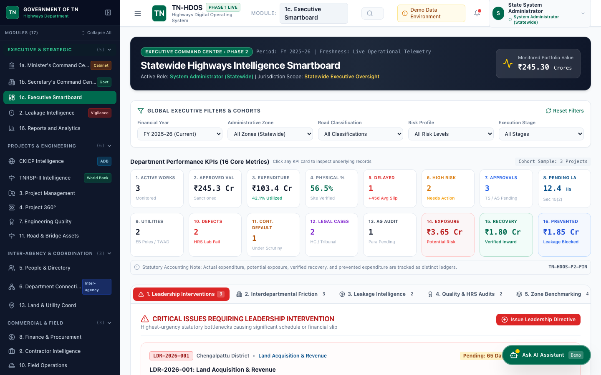
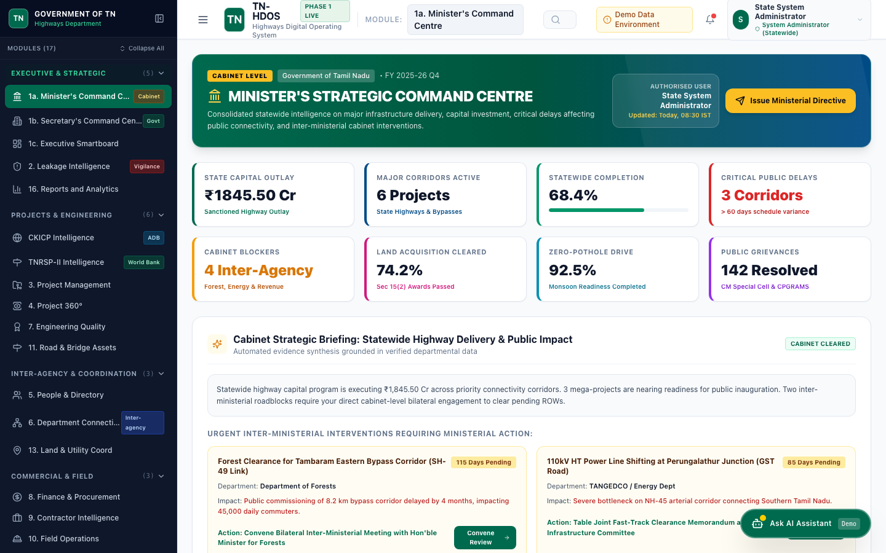
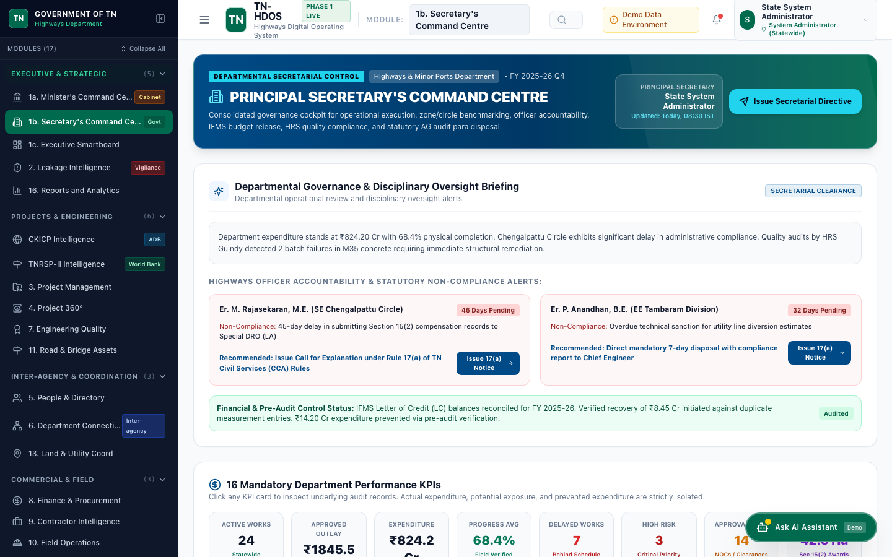
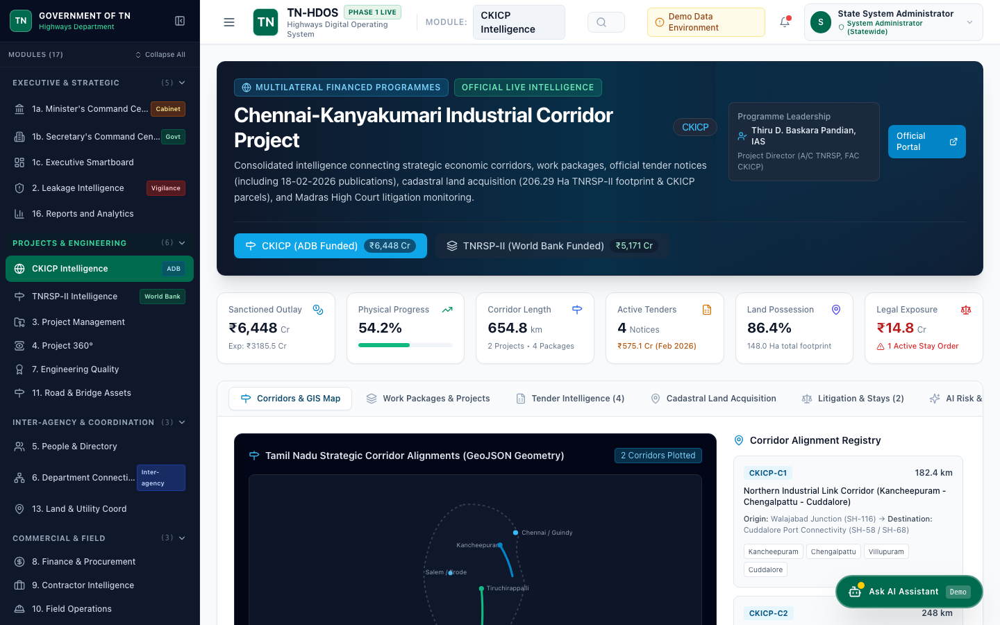
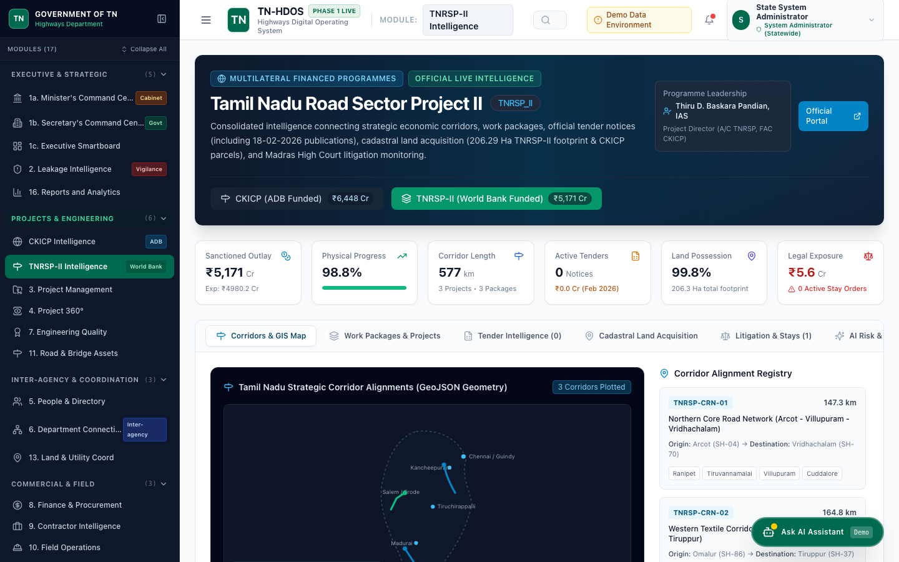
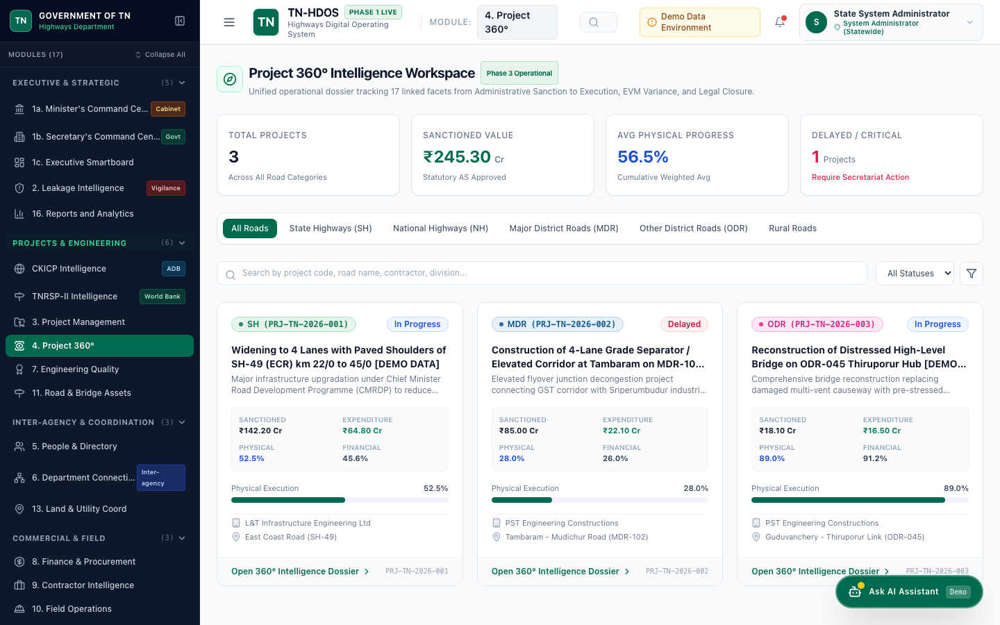
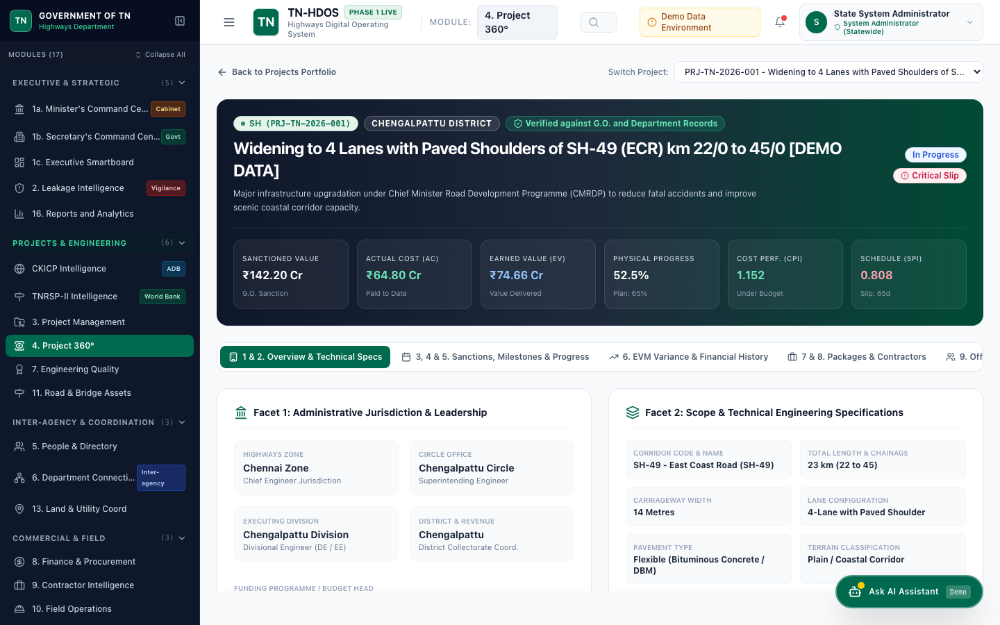
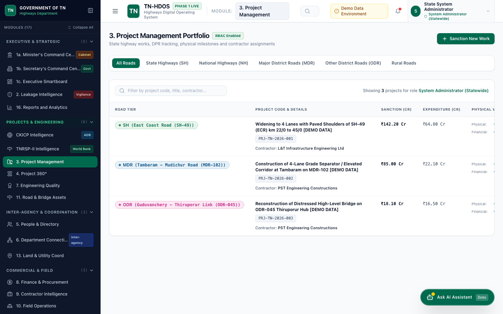
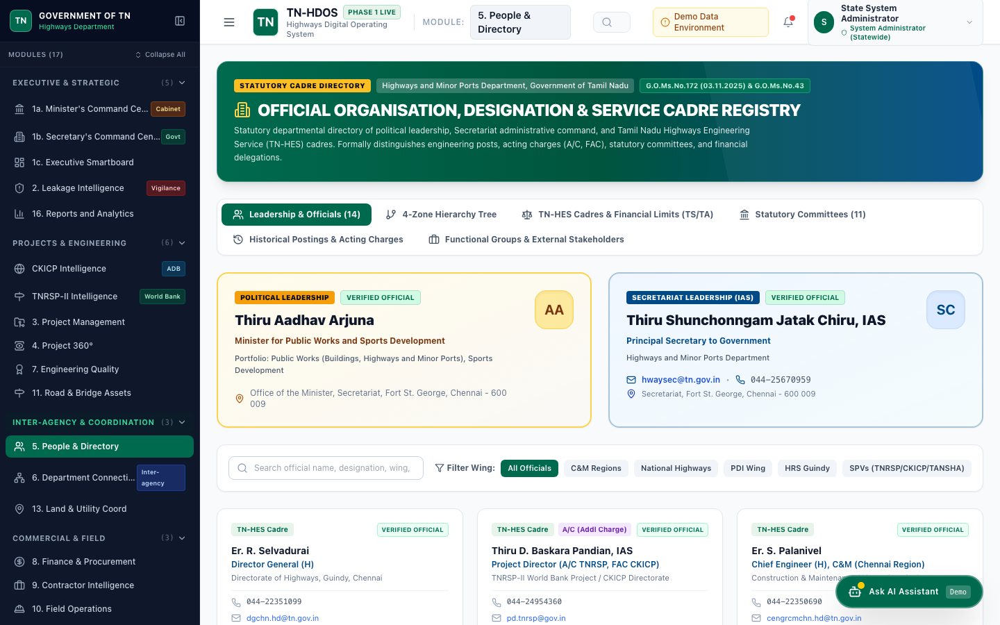
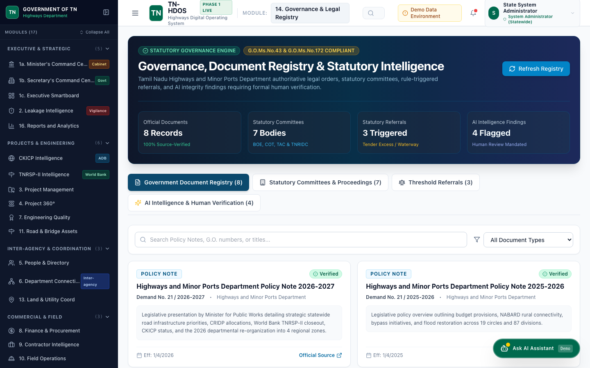

# TN-HDOS: Tamil Nadu Highways Digital Operating System

<div align="center">

[](https://www.tn.gov.in)
[](https://www.tnhighways.gov.in)
[](https://kiru6006.github.io/govt-highways-agent/)
[-006A4E?style=for-the-badge)](docs/TESTING_AND_VERIFICATION.md)
[](docs/PHASE_17_AUDIT_REPORT.md)

### An Integrated Enterprise Operating Platform for Statewide Infrastructure Governance, Project Intelligence, Inter-Agency Coordination & Decision Support

**Official Portal**: [https://kiru6006.github.io/govt-highways-agent/](https://kiru6006.github.io/govt-highways-agent/)

</div>

---

## 🏛️ Executive Overview

The **Tamil Nadu Highways Digital Operating System (TN-HDOS)** is the mission-critical digital operating platform developed for the **Highways and Minor Ports Department, Government of Tamil Nadu**.

Spanning over **73,000+ kilometres** of road infrastructure across 4 Administrative C&M Zones, 8 Specialized Wings, 40+ Circles, and 100+ Divisions, TN-HDOS transitions departmental administration from physical file dockets, disparate spreadsheets, and delayed reporting into a single, connected, and auditable digital intelligence console.

### Key Questions Answered for Departmental Leadership:
* **Hon'ble Minister**: Which flagship projects are delayed? What are the constituency-level delivery dates? Are there public grievances or inauguration-ready assets?
* **Principal Secretary**: Where are inter-departmental clearances (Revenue, TANGEDCO, Forest, Southern Railway) blocked? What is the budget expenditure (BE/RE) run-rate? Which contractors are lagging?
* **Director General & Chief Engineers**: What is the root cause of project delay? Is it Land Acquisition (LA), utility shifting, or contractor cash-flow? What statutory committee approvals are due?
* **Superintending & Divisional Engineers**: What is the Earned Value ($EV, PV, AC$) variance on my division's packages? Are quality test cube results compliant with MORTH specifications?

---

## 🚀 Active & Completed Operational Workspaces

TN-HDOS delivers connected operational workspaces designed specifically for the hierarchy of the Tamil Nadu Highways and Minor Ports Department:

```
┌───────────────────────────────────────────────────────────────────────────────────────────────┐
│                                TAMIL NADU HIGHWAYS DIGITAL OPERATING SYSTEM                   │
├───────────────────────────────┬───────────────────────────────┬───────────────────────────────┤
│    EXECUTIVE COMMAND CENTRE   │     PROJECT 360° INTELLIGENCE │   MULTILATERAL PROGRAMMES     │
│  • CM Highways Smartboard     │  • Standalone Dossier Engine  │  • CKICP Intelligence (ADB)   │
│  • Minister Cabinet Suite     │  • 16 Connected Facets        │  • TNRSP-II Intelligence (WB) │
│  • Principal Secretary Suite  │  • EVM Variance (CPI / SPI)   │  • 206.29 Ha Land Parcels     │
│  • Executive Smartboard (/#/) │  • Universal Graph Explorer   │  • High Court Stay Injunctions│
├───────────────────────────────┼───────────────────────────────┼───────────────────────────────┤
│   ORGANISATION & CADRE        │   GOVERNANCE & DIGITAL OFFICE │   COMMERCIAL & FIELD CONSOLES │
│  • 4-Zone Command Hierarchy   │  • Digital Office E-Files     │  • Responsive Portfolio Table │
│  • 8 Statewide Wings          │  • 8 Statutory Committees     │  • Material Lab QA & NCRs     │
│  • G.O. Ms. No. 75 Powers     │  • High Court Writ Register   │  • Field Daily Progress Logs  │
│  • External Agency SPOCs      │  • Immutable Audit Trail      │  • Multi-tenant Contractor App│
└───────────────────────────────┴───────────────────────────────┴───────────────────────────────┘
```

---

## 🗺️ Complete Menu Structure, Operational Guide & Data Availability

The platform is structured into **6 Functional Enterprise Domains (22 Connected Workspaces)** plus a **Compact Top Header Utility Bar**:

```
SIDEBAR NAVIGATION (6 FUNCTIONAL DOMAINS)
├── 🏛️ Domain 1: Strategic Command (Apex Layer - 6 items)
│   ├── CM Highways Smartboard [CMO]          → /cm-dashboard
│   ├── Minister's Command Centre [Cabinet]   → /leadership/minister
│   ├── Secretary's Command Centre [Govt]     → /leadership/secretary
│   ├── Organisation & Jurisdiction [G.O. 43] → /organisation-intelligence
│   ├── Executive Smartboard                  → /
│   └── Reports & Analytics                   → /reports
├── 🏗️ Domain 2: Project Intelligence (Core Layer - 5 items)
│   ├── Project Portfolio Grid                → /projects
│   ├── Project 360° Dossier                  → /project-360
│   ├── CRIDP Work Verification [Five-Year]   → /cridp-verification
│   ├── CKICP Intelligence [ADB]              → /ckicp
│   └── TNRSP-II Intelligence [World Bank]    → /tnrsp
├── 🛠️ Domain 3: Engineering & Field Ops (Operational Layer - 3 items)
│   ├── Field Operations                      → /field-ops
│   ├── Engineering Quality                   → /quality
│   └── Road & Bridge Assets                  → /assets
├── 💰 Domain 4: Commercial & Resource Mgmt (Support Layer - 3 items)
│   ├── Finance & Procurement                 → /finance
│   ├── Contractor Intelligence               → /contractors
│   └── People & Directory                    → /directory
├── ⚖️ Domain 5: Governance & Coordination (Control Layer - 5 items)
│   ├── Dept. Connections [Inter-agency]      → /departments
│   ├── Land & Utility Coord                  → /land-utility
│   ├── Governance & Legal [Statutory]        → /compliance
│   ├── Citizen Services                      → /citizen-services
│   └── Leakage Intelligence [Vigilance]      → /leakage
└── 📁 Domain 6: Digital Office & Utilities (Utility Layer - 5 items)
    ├── Digital Office                        → /digital-office
    ├── Unified Calendar                      → /calendar
    ├── Discussions & Chat [Govt]             → /messages
    ├── Notifications & Alerts [Live]         → /notifications
    └── System Administration                 → /admin

TOP HEADER UTILITY BAR
├── Universal Cross-Entity Search (Cmd/Ctrl + K)
├── Notification Center (Drawer)
├── Unified Calendar Quick-Link
├── Secure Chat & Discussion Counter
├── Theme Palette Switcher (Navy Gov vs. Forest Green)
└── Role Persona Switcher (CM, Minister, Secretary, CE, SE, DE, Contractor)
```

---

### Group 1: Executive & Strategic Workspaces

#### 1. CM Highways Smartboard (`#/cm-dashboard`)
* **Target Audience**: Hon'ble Chief Minister (**Thiru C. Joseph Vijay**), CMO Principal Secretaries, Cabinet Observers.
* **Key Capabilities & How to Use**:
  * **17 Apex KPIs**: Total outlay (₹ Cr), active road length (km), EVM variance ($CPI, SPI$), critical delays, pending statutory clearances.
  * **8-Zone State Pulse Map**: Comparative delivery index across Chennai, Coimbatore, Madurai, Trichy, Salem, Tirunelveli, Villupuram, and Thanjavur.
  * **Delay Root-Cause Breakdown**: Critical path vs. non-critical parallel delays (prevents double-counting).
  * **CM Directions Queue**: Track formal directives issued to Principal Secretary and Chief Engineers with compliance status.
  * **Grounded AI Daily Brief**: Neutral ministerial summary generated from live project and dispute registers with cited statutory sources.
* **Data Availability & Seed Records**:
  * Seeded with 12 state projects + 4 canonical governance archetypes (`backend/app/seed_universal_connectivity.py`).
  * Endpoints: `GET /api/v1/cm/overview`, `GET /api/v1/cm/delays/analysis/{id}`, `GET /api/v1/cm/directions`, `GET /api/v1/cm/ai-daily-brief`.

#### 2. Minister's Command Centre (`#/leadership/minister`)
* **Target Audience**: Hon'ble Minister for Public Works & Highways (**Thiru Aadhav Arjuna**).
* **Key Capabilities & How to Use**:
  * **Constituency Delivery Radar**: Filter projects by Assembly Constituency and District to verify localized progress.
  * **CM Flagship Announcements**: Monitor progress on special infrastructural corridor announcements.
  * **Inauguration Readiness Register**: Identifies packages reaching 100% physical completion for public dedication.
* **Data Availability & Seed Records**:
  * Seeded projects mapped to real Tamil Nadu districts (Kancheepuram, Tiruvallur, Salem, Ariyalur, Vellore).
  * Endpoints: `GET /api/v1/executive/minister`.

#### 3. Secretary's Command Centre (`#/leadership/secretary`)
* **Target Audience**: Principal Secretary to Government (**Thiru Shunchonngam Jatak Chiru, IAS**).
* **Key Capabilities & How to Use**:
  * **Budget Tracking (BE / RE)**: Real-time analysis of Budget Estimates (BE), Revised Estimates (RE), and actual expenditure run-rate.
  * **Statutory Committee Approvals**: Agenda items and pending clearances before the Board of Engineers (BOE), Committee of Terms (COT), and Standing Finance Committee (SFC).
  * **Contractor Performance Scorecards**: Multi-criteria contractor risk metrics, liquidity ratios, and lagging package alerts.
* **Data Availability & Seed Records**:
  * Financial records linked with BE/RE allocation dockets across all active packages.
  * Endpoints: `GET /api/v1/executive/secretary`.

#### 4. Organisation & Jurisdiction Intelligence (`#/organisation-intelligence`)
* **Governing Statute**: G.O. (Ms) No. 43, Highways and Minor Ports (HN1) Department, dated 13 March 2026 (Effective 15 June 2026).
* **Target Audience**: Chief Engineers, Superintending Engineers, Divisional Engineers, State Planning Cadre, Finance Auditors.
* **Key Capabilities & How to Use**:
  * **Canonical 5-Level Hierarchy Bar**: Standardized cascading filter (`Wing -> Region -> Circle -> Division -> Subdivision -> District`) governing all analytics and CRIDP verifications.
  * **Quad-Zonal C&M Command**: Full jurisdictional breakdown across 4 Regions (Chennai, Trichy, Madurai, Coimbatore), 19 Circles, 68 Divisions, 285 Subdivisions, and exactly 68,149.618 km total road length.
  * **National Highways Branch Isolation**: Demarcated 4 Circles and 11 Divisions, isolated with `PENDING_VERIFICATION` status to prevent cross-wing data leakage.
  * **7 Connected Intelligence Tabs**:
    * *Tab A (Statewide Organisation Overview)*: Zonal delivery cards, road lengths, and statutory governance principles.
    * *Tab B (Organisation Explorer)*: Interactive collapsible hierarchy tree with detailed unit dossiers and assigned works.
    * *Tab C (Works Analytics Sync)*: Synchronized tabular works explorer filtered dynamically by active jurisdiction.
    * *Tab D (CRIDP Renewal Verification)*: Chainage-level 5-year renewal eligibility and premature overlap audits.
    * *Tab E (Risk & Financial Exposure)*: Aggregated execution delays, critical blockers, and avoidable costs by zone.
    * *Tab F (Historical Reorganisation)*: G.O. 43 Annexure-III Old-to-New Division mapping register with all 19 redesignations.
    * *Tab G (Data Quality & Mapping Exceptions)*: Unresolved legacy record queue with Chief Engineer statutory resolution workflow.
* **Data Availability & Seed Records**:
  * Deterministically parsed from `CM_Wing_Reorganisation_GO43_13-03-2026.xlsx` (`backend/app/seed_organisation_master.py`).
  * 398 canonical `OrganisationUnit` records, 19 `HistoricalOrganisationMapping` entries, initial `DataQualityMappingException` audit records.
  * Endpoints: `GET /api/v1/organisation-blueprint/hierarchy`, `GET /api/v1/organisation-blueprint/unit/{id}`, `GET /api/v1/organisation-blueprint/filter-options`, `GET /api/v1/organisation-blueprint/historical-mappings`, `GET /api/v1/organisation-blueprint/kpis`, `GET /api/v1/organisation-blueprint/exceptions`, `POST /api/v1/organisation-blueprint/resolve-exception`.

#### 5. Executive Smartboard (`#/`)
* **Target Audience**: Departmental Leadership, Chief Engineers, Planning Directors.
* **Key Capabilities & How to Use**:
  * Real-time statewide pulse: 16 core KPIs, 4 C&M Administrative Zone benchmarks, inter-agency blocker summaries.
* **Data Availability & Seed Records**:
  * 73,000+ km network aggregates, ₹14,000+ Cr capital expenditure portfolio.
  * Endpoints: `GET /api/v1/executive/overview`.

#### 5. Notifications & Alerts (`#/notifications`)
* **Target Audience**: All Officers & Engineers.
* **Key Capabilities & How to Use**: Role-filtered notifications sorted by severity (`CRITICAL`, `WARNING`, `INFO`). Actionable links directly open the blocked package or statutory file.
* **Data Availability & Seed Records**: 12 seeded real-time notification streams with timestamped statutory audit trails.
* **Endpoints**: `GET /api/v1/notifications/`, `POST /api/v1/notifications/{id}/read`.

#### 6. Unified Calendar (`#/calendar`)
* **Target Audience**: Executive Cadre, Project Directors, Legal Officers.
* **Key Capabilities & How to Use**: Month, week, and list views of tender opening dates, High Court stay hearings, PAC audit submissions, and site review milestones.
* **Data Availability & Seed Records**: 25+ calendar milestones linked with project foreign keys.
* **Endpoints**: `GET /api/v1/calendar/events`.

#### 7. Discussions & Chat (`#/messages`)
* **Target Audience**: Authorized Departmental Officers, Project Teams, External Line Agency SPOCs.
* **Key Capabilities & How to Use**: 1-to-1 official messaging, group channels by project or committee, document attachment sharing, and automated AI action-point extraction.
* **Data Availability & Seed Records**: 8 pre-seeded official threads (e.g., CPRR Section-2 Coordination, Palar Bridge Land Compensation).
* **Endpoints**: `GET /api/v1/messaging/conversations`, `POST /api/v1/messaging/send`.

#### 8. Leakage Intelligence (`#/leakage`)
* **Target Audience**: Departmental Vigilance Officers, State Quality Council, Financial Auditors.
* **Key Capabilities & How to Use**: Automated anomaly detection flagging asphalt volume inflation, ghost billing, contractor bid clustering, and PAC audit paras.
* **Data Availability & Seed Records**: 12 seeded anomaly categories with risk ratings and monetary recovery tracking.
* **Endpoints**: `GET /api/v1/leakage/anomalies`.

#### 9. Reports & Analytics (`#/reports`)
* **Target Audience**: Planning Officers, Statistical Officers, Ministerial Staff.
* **Key Capabilities & How to Use**: Generate formatted PDF/CSV reports, G.O. compliance summaries, and interactive 5-question AI executive briefings.
* **Data Availability & Seed Records**: Department-wide analytics engine synthesizing physical and financial progress.
* **Endpoints**: `GET /api/v1/reports/`.

---

### Group 2: Projects & Engineering Workspaces

#### 10. CKICP Intelligence (`#/ckicp`)
* **Target Audience**: Project Director (CKICP), Asian Development Bank (ADB) Mission Teams.
* **Key Capabilities & How to Use**: Multilateral corridor intelligence monitoring 16 EPC packages, supervision consultant performance, e-tender stages, and corridor GeoJSON alignments.
* **Data Availability & Seed Records**: 4 major ADB corridors (`PRJ-CKICP-001` through `004`) with ₹6,448 Cr outlay.
* **Endpoints**: `GET /api/v1/ckicp/packages`.

#### 11. TNRSP-II Intelligence (`#/tnrsp`)
* **Target Audience**: Project Director (TNRSP-II), World Bank Review Teams.
* **Key Capabilities & How to Use**: Audited register of **206.29 Hectares** of acquired land, environmental clearances, and social safeguards compliance across 16 EPC packages.
* **Data Availability & Seed Records**: 3 World Bank corridor packages (`PRJ-TNRSP-001` through `003`) with verified cadastral data.
* **Endpoints**: `GET /api/v1/tnrsp/corridors`.

#### 12. Project Management (`#/projects`)
* **Target Audience**: Chief Engineers, Superintending Engineers, Divisional Engineers.
* **Key Capabilities & How to Use**: Statewide responsive table with horizontal scroller, multi-column search, dual progress bars (physical vs. financial), and direct links to Project 360°.
* **Data Availability & Seed Records**: 12 core highway projects covering SH, NH, MDR, and ODR road categories.
* **Endpoints**: `GET /api/v1/projects/`.

#### 13. Project 360° Unified Intelligence (`#/project-360`)
* **Target Audience**: All Engineering and Administrative Officers.
* **Key Capabilities & How to Use**: 16 connected tabs including:
  * *Tab 1: Project Overview & Scope*
  * *Tab 2: Financial Sanctions & Contracts*
  * *Tab 3: EVM Mathematical Engine* ($CV = EV - AC, SV = EV - PV, CPI = EV/AC, SPI = EV/PV$)
  * *Tab 4: Cadastral Land Acquisition* (Survey numbers, Sec 15(2), compensation status)
  * *Tab 5: Utility Shifting* (TANGEDCO poles, TWAD pipelines, Forest felling)
  * *Tab 6: Engineering Quality Audits* (Lab cube tests, MORTH specs, NCRs)
  * *Tab 7: Legal Cases & High Court Stays*
  * *Tab 16: Universal Connectivity Graph Explorer* (Interactive visual node-link topology)
* **Data Availability & Seed Records**: Detailed dossiers for all projects (`/project-360?id=1` to `id=12`).
* **Endpoints**: `GET /api/v1/projects/{id}/360`, `GET /api/v1/connectivity/entities/PROJECT/{id}/relationships`.

#### 14. Statewide CRIDP Work Verification & Risk Intelligence (`#/cridp-risk-intelligence` & `#/cridp-verification`)
* **Display Title**: **Statewide CRIDP Work Verification & Risk Intelligence**
* **Target Audience**: Chief Engineers, Superintending Engineers, Divisional Engineers, Planning & Finance Specialists, Pavement & Quality Auditors.
* **Governing Statutory Framework**:
  * **Tamil Nadu State Highways Authority (TANSHA)**: Created under **The Tamil Nadu State Highways Authority Act, 2024 (TN Act No. 12 of 2024)** for statewide high-speed corridors, expressways, and outer ring networks. Integrated in Organisation Directory, Statutory Structure, and Executive Smartboard.
  * **Technical Sanction Delegation**: **G.O.(Ms) No. 11**, Highways and Minor Ports (HN.2), dated 21.01.2022 (Divisional Engineer up to ₹50 Lakhs, Superintending Engineer up to ₹7.00 Crores, Chief Engineer full powers above ₹7.00 Crores).
  * **Tender Acceptance Delegation**: **G.O.(Ms) No. 29**, dated 03.03.2022 restoring **G.O.(Ms) No. 163**, dated 01.10.2012 (Divisional Engineer up to ₹50 Lakhs at 0% excess, Superintending Engineer up to ₹1.00 Crore with ≤5% tender excess, Chief Engineer up to ₹6.00 Crores at 0% excess, Committee of Chief Engineers COT up to ₹100.00 Crores with ≤10% tender excess).
  * **Five-Year Renewal Policy**: **G.O. Ms. No. 84** (5-year lock-in restriction on surface renewals) and **G.O.(Ms) No. 105**, dated 02.07.2025 (CRIDP 2025-2026 Works Schedule).
* **The 5 Core Investigation Facets Answered For Every Proposed Work**:
  1. *What work was previously sanctioned or completed on this road stretch?*
  2. *What went wrong, or what remains unverified, in the previous work?*
  3. *What caused the problem, and what evidence supports that conclusion?*
  4. *How is the issue currently being managed, by whom and within what deadline?*
  5. *Should the proposed new work proceed, require modification or be referred for further technical verification?*
* **11 Mandated Interactive Dashboard Tabs**:
  * **Tab 1: Statewide Risk Overview**: 14 dynamically calculated KPIs (total CRIDP works, historical works assessed, premature proposals, partial overlaps, unresolved previous issues, disputed completions, open & overdue corrective actions, avoidable expenditure).
  * **Tab 2: Previous Work Investigation**: Interactive Dossier selector covering 12 deliberately designed canonical investigation scenarios (`SCN-01` through `SCN-12`) with Chief Engineer authoritative verdict recording form.
  * **Tab 3: Five-Year Renewal Verification**: Deterministic day-level arithmetic enforcing the 5-year lock-in window unless supported by Highways Research Station (HRS) core deflection tests.
  * **Tab 4: Duplicate & Overlap Detection**: Mathematical 1D interval union algorithm $\bigcup [a_i, b_i]$ with visual chainage bars preventing double-counting.
  * **Tab 5: Delay & Root Cause Analysis**: Planned vs actual vs forecast milestone comparison, critical-path delay quantification, and causal responsibility partitioning (Contractor, Department, Shared, External).
  * **Tab 6: Contractor Performance & Accountability**: Prime contractor risk scorecards, active vs delayed packages, schedule variances, and liquidated damages tracking.
  * **Tab 7: Financial Exposure & Leakage Prevention**: Mathematically rigorous separation between Gross Potential Exposure and Confirmed Avoidable Expenditure (protects against false leakage accusations).
  * **Tab 8: Corrective Action & Mitigation Tracker**: End-to-end corrective action pipeline (`OPEN` $\rightarrow$ `CLOSED`), designated action owners, deadlines, and multi-tier escalations (Division $\rightarrow$ Circle $\rightarrow$ Chief Engineer $\rightarrow$ Secretary).
  * **Tab 9: Year-wise Eligible Road Length**: Multiannual network unlocking projections from FY 2026-27 to 2030-31 distinguishing historically eligible, administratively available, technically recommended, and approved lengths.
  * **Tab 10: Data Quality & Lineage**: 12 anomaly categories grounded in `Predefined Report (1).csv` rows, `CRIDP-2025-2026-Annexures-.pdf` pages, and circle measurement book references.
  * **Tab 11: Reports & AI Insights**: Interactive Ask AI Assistant answering strategic Chief Engineer queries with verified government citations.
* **Data Provenance & Seed Records**:
  * 204 verified historical works (`WorkHistory`) across 38 Tamil Nadu districts.
  * 96 CRIDP work proposals (`CRIDPWork`) for FY 2026-27.
  * 96 deep investigation dossiers (`CRIDPInvestigation`) including `SCN-01` to `SCN-12`.
  * 45 tracked corrective actions (`CRIDPCorrectiveAction`).
  * 30 data quality findings (`CRIDPDataQualityFinding`).
* **Automated Acceptance Test Coverage**:
  * `tests/test_cridp_verification.py`: 20/20 tests passing.
  * `tests/test_cridp_risk_intelligence.py`: 25/25 acceptance criteria tests passing.
  * `tests/test_cridp_advanced_filter.py`: 20/20 acceptance criteria tests passing (Section 10).
  * Total: **65 automated CRIDP backend tests passing with 100% success**.
* **Statewide CRIDP Advanced Filtering, Search & Drill-Down Engine**:
  * **Global Persistent Filter Bar**: Top-level bar synchronized across all 11 tabs, KPI cards, tables, investigations, and charts.
  * **8 Chief Engineer Preset Views**:
    1. `PRESET_5YR_DUPLICATE`: 5-Year Duplicate Verification (flagged renewals within 5-yr lock).
    2. `PRESET_UNCLOSED_PREVIOUS`: Previous Work Not Properly Closed (physical/financial discrepancy, uncertified 100% progress).
    3. `PRESET_HIGH_FINANCIAL_RISK`: High Financial Risk (avoidable duplicate exposure > ₹50 Lakhs).
    4. `PRESET_CRITICAL_DELAYS`: Critical Project Delays (active work delayed > 180 days).
    5. `PRESET_LAND_LITIGATION_BLOCKERS`: Land, Litigation & Utility Blockers (stay orders, LA stalls, utility shifting).
    6. `PRESET_CONTRACTOR_PERFORMANCE`: Contractor Performance Review (multiple delayed packages under low-score contractors).
    7. `PRESET_FREE_STRETCHES`: Year-wise Free Road Stretches (0% overlap, eligible for sanction).
    8. `PRESET_DATA_VERIFICATION`: Data Verification Required (missing chainage, unverified completion dates).
  * **Category-Based Unified Search**: Instant lookups by `ALL`, `ROAD`, `WORK_CODE`, `DISTRICT`, `DIVISION`, `CONTRACTOR`, `G.O.`, or `RISK`.
  * **Dependent Administrative Cascading**: State (TN) $\rightarrow$ Circle $\rightarrow$ Division $\rightarrow$ District. Accurately accounts for non-1:1 relationship between divisions and revenue districts.
  * **1D Chainage Interval Overlap Querying**: Evaluates whether $[s_i, e_i]$ overlaps requested range $[S_{\min}, E_{\max}]$ ($e_i > S_{\min} \land s_i < E_{\max}$).
  * **Financial Unit Consistency**: Seamless bidirectional handling of ₹ in Lakhs and ₹ in Crores.
  * **Multiannual Year-Wise Comparison Matrix**: Cross-year matrix comparing FY 2024-25, 2025-26, and 2026-27 with total works, proposed length, sanction amount, avoidable expenditure, and delta findings.
  * **Direct RFC 4180 CSV Export**: Generates filtered proposal reports respecting all active parameters.
* **Endpoints**:
  * `GET /api/v1/cridp-verification/hierarchy`
  * `POST /api/v1/cridp-verification/advanced-filter`
  * `POST /api/v1/cridp-verification/year-wise-comparison`
  * `POST /api/v1/cridp-verification/export-filtered`
  * `GET /api/v1/cridp-verification/risk-overview`
  * `GET /api/v1/cridp-verification/investigations`
  * `GET /api/v1/cridp-verification/investigations/{proposal_id}`
  * `POST /api/v1/cridp-verification/investigations/{proposal_id}/decision`
  * `GET /api/v1/cridp-verification/delays-and-root-causes`
  * `GET /api/v1/cridp-verification/contractor-accountability`
  * `GET /api/v1/cridp-verification/corrective-actions`
  * `POST /api/v1/cridp-verification/corrective-actions`
  * `PUT /api/v1/cridp-verification/corrective-actions/{action_id}`
  * `GET /api/v1/cridp-verification/data-quality`
  * `POST /api/v1/cridp-verification/ai-risk-analyst`
  * `GET /api/v1/cridp-verification/kpis`

#### 15. Unified Works Status Analytics (`#/works-analytics`)
* **Display Title**: **Unified Works Analytics: Synchronized Data Explorer, Charts, Filters and Risk Intelligence**
* **Target Audience**: Chief Engineers, Superintending Engineers, Divisional Engineers, Government Auditors, Finance & Planning Officers.
* **Navigation Path**: Works Management $\rightarrow$ Works Status Analytics (`#/works-analytics`)
* **Key Capabilities & Architecture**:
  * **Dual Synchronized Workspace Architecture**:
    * **Tab 1: Works Data Explorer**: High-performance 55+ column tabular master with search, multi-column sort, 5 column visibility presets (`Core PMS`, `Financials`, `Timeline & Delays`, `Blockers & 5-Yr`, `All Columns`), and full 360° slide-over dossier inspection.
    * **Tab 2: Works Analytics & Charts**: 10 interactive, responsive visual intelligence charts (A through J) with click-to-filter drill-down directly focusing Tab 1.
  * **Single Source of Truth**: Both tabs share identical state, active filters, URL bookmarking parameters, and reporting snapshot.
  * **10 Top Clickable Synchronized KPI Cards**:
    1. *Total Works & Total Length (km)*
    2. *Completed Works (with completed length km)*
    3. *Work in Progress (active site count)*
    4. *Forecast Delay (schedule risk)*
    5. *Agreement Date Slippage (> contracted end date)*
    6. *Critical Financial Exposure & Risks*
    7. *CRIDP 5-Year Warranty Overlap (avoidable ₹ Cr)*
    8. *Pre-Construction Pipeline (LA, DPR, Tender, Estimate)*
    9. *Total Sanction Value (AS ₹ Cr)*
    10. *Total Expenditure Booked vs Contract Agreement*
  * **Interactive Visual Intelligence Suite (Charts A to J)**:
    * **Chart A: Work Progress Bands**: Disjoint partition into non-overlapping bands (`0–10%`, `10–25%`, `26–50%`, `51–75%`, `76–90%`, `91–100%`). Clicking any bar filters Tab 1.
    * **Chart B: Potential Delay Categorization**: Donut chart partitioning forecast delays (`No Delay`, `< 30 Days`, `30-90 Days`, `91-180 Days`, `> 180 Days`).
    * **Chart C: Agreement End-Date Slippage**: Bar distribution of elapsed time past contract deadline (`1–2 Months`, `3–6 Months`, `More Than 6 Months`).
    * **Chart D: Pre-Construction Pipeline**: Stage-wise funnel across LA, DPR, Tender, Estimate, and To Be Started.
    * **Chart E: Financial Performance Comparison**: Direct comparison of AS Amount vs TS Amount vs Contract Value vs Expenditure Incurred.
    * **Chart F: Circle Delivery Performance Matrix**: Multi-metric breakdown across SE Circles comparing completed, delayed, and critical-risk works.
    * **Chart G: Scheme Performance Matrix**: Comparative analysis across CRIDP Regular, CRIDP SCP, CKICP, TNRSP-II, CMRDP, SASCI, and State Road Fund.
    * **Chart H: Critical Risk & Blocker Distribution**: Horizontal bar chart isolating Land Acquisition, Utility Shifting, Railway GAD Approvals, Forest Clearances, and High Court Stays.
    * **Chart I: Year-wise Work Trends**: Multiannual tracking of works sanctioned, works completed, and expenditure.
    * **Chart J: CRIDP 5-Year Renewal Scrutiny**: Quantitative breakdown of eligible length, locked warranty length, direct overlaps, and proposals requiring technical reduction.
  * **Multi-Sheet Excel (.xlsx) & CSV Export Engine**:
    * Generates 5-sheet formatted `.xlsx` workbooks: `Filtered Works`, `KPI Summary`, `Risk Findings`, `Data Quality Exceptions`, and `Filter Criteria & Metadata`.
    * **Formula Injection Guard**: Escapes leading `=`, `+`, `-`, and `@` characters with a leading single quote `'` on all cells.
  * **360° Work Dossier Slide-Over**:
    * 6 inspection sections: Administrative Jurisdiction, Road Inventory & Scope, Financial Sanctions & Contracts, Progress & Timeline, Inter-departmental Clearances, and CRIDP 5-Year Audit Findings.
* **Data Provenance & Seed Records**:
  * 169 canonical highway works populated in `UnifiedWorkRecord` with realistic road numbers (`SH-02`, `SH-110`, `SH-72`, `MDR-280`), official contractor names, and dependency blockers.
* **Automated Acceptance Tests**:
  * `backend/tests/test_works_analytics.py`: 12/12 tests passing with 100% success.
  * Total combined CRIDP and Works Analytics tests: **77 passing automated tests**.
* **Endpoints**:
  * `GET /api/v1/works-analytics/filter-registry`
  * `POST /api/v1/works-analytics/query`
  * `POST /api/v1/works-analytics/kpis`
  * `POST /api/v1/works-analytics/charts`
  * `POST /api/v1/works-analytics/export` (`format=excel` | `format=csv`)
  * `GET /api/v1/works-analytics/work/{work_id}`
  * `GET /api/v1/cridp-verification/proposals`
  * `POST /api/v1/cridp-verification/check-overlap`
  * `GET /api/v1/cridp-verification/year-wise-eligibility`
  * `GET /api/v1/cridp-verification/hierarchy-breakdown`
  * `GET /api/v1/cridp-verification/delegation-rules`

#### 15. Engineering Quality Assurance (`#/quality`)
* **Target Audience**: Superintending Engineer (Quality Control), Lab Directors, Independent Consultants.
* **Key Capabilities & How to Use**: Monitor 7-day and 28-day concrete cube compressive strengths, bitumen penetration and ductility results, and track open Non-Conformance Reports (NCR).
* **Data Availability & Seed Records**: 34 lab audits and 25 NCRs across active road packages.
* **Endpoints**: `GET /api/v1/quality/audits`, `POST /api/v1/quality/ncr`.

#### 16. Road & Bridge Asset Management (`#/assets`)
* **Target Audience**: Pavement Management Engineers, Bridge Inspection Units.
* **Key Capabilities & How to Use**: Road Asset Management System (RAMS) tracking Pavement Condition Index (PCI), bridge structural distress, culvert status, and routine maintenance work orders.
* **Data Availability & Seed Records**: 40 geo-located asset records with condition ratings and photographic evidence links.
* **Endpoints**: `GET /api/v1/assets/`.

---

### Group 3: Inter-Agency & Coordination Workspaces

#### 17. People & Organisation Directory (`#/directory`)
* **Target Audience**: Departmental Officers, Secretariat Staff, External Agencies.
* **Key Capabilities & How to Use**: Interactive organizational tree spanning Minister $\rightarrow$ Principal Secretary $\rightarrow$ DG $\rightarrow$ CE $\rightarrow$ SE $\rightarrow$ DE. Codified financial delegation thresholds under **G.O. Ms. No. 75**, G.O. Ms. No. 11, and TANSHA statutory framework (**TN Act 12 of 2024**).
* **Data Availability & Seed Records**: Complete TN-HES cadre hierarchy with phone, email, and designated external agency SPOCs.
* **Endpoints**: `GET /api/v1/directory/officers`.

#### 18. Departmental Coordination & Clearances (`#/departments`)
* **Target Audience**: Departmental Nodal Officers, Secretariat Coordinators.
* **Key Capabilities & How to Use**: Track statutory clearances across 10 line departments (Revenue, TANGEDCO, TWAD, Forest, Southern Railway), SLA countdowns, and escalation matrices.
* **Data Availability & Seed Records**: 28 active interdepartmental dependencies and 40 approval records.
* **Endpoints**: `GET /api/v1/departments/`.

#### 18. Land Acquisition & Utility Intelligence (`#/land-utility`)
* **Target Audience**: Special DROs (LA), Tahsildars, Executive Engineers.
* **Key Capabilities & How to Use**: Cadastral parcel maps, village-level survey numbers, notification stages under TN Highways Act 2001 (Act 34/2002), compensation disbursements, and utility pole/pipeline shifting status.
* **Data Availability & Seed Records**: 50 cadastral land parcels and 25 utility shifting records.
* **Endpoints**: `GET /api/v1/land-utility/`.

---

### Group 4: Commercial, Contractors & Field Workspaces

#### 19. Finance & Procurement (`#/finance`)
* **Target Audience**: Accounts Officers, Financial Advisers, Tender Scrutiny Committees.
* **Key Capabilities & How to Use**: Track Administrative Sanctions (AS), Technical Sanctions (TS), contractor running account (RA) bills, retention money, and Bank Guarantee (BG) expiry alerts.
* **Data Availability & Seed Records**: Sanction records, contract agreements, and bill processing logs.
* **Endpoints**: `GET /api/v1/finance/`.

#### 20. Contractor Intelligence (`#/contractors`)
* **Target Audience**: Chief Engineers, Tender Award Committees.
* **Key Capabilities & How to Use**: Multi-criteria performance ratings, capacity utilization, workload concentration risk, active package lists, and liquidity warnings.
* **Data Availability & Seed Records**: 8 registered A-class EPC contractors (L&T, SPK Infra, PST, Tamil Construction Co, etc.).
* **Endpoints**: `GET /api/v1/contractors/`.

#### 21. Field Operations (`#/field-ops`)
* **Target Audience**: Assistant Engineers, Site Supervisors, Field Quality Monitors.
* **Key Capabilities & How to Use**: Review daily site progress reports (DPR), geo-tagged photo submissions, plant and machinery deployment (pavers, rollers, batching plants), and weather impact logs.
* **Data Availability & Seed Records**: 30 daily site entries with chainage stamps.
* **Endpoints**: `GET /api/v1/field-ops/`.

---

### Group 5: Governance & Public Administration Workspaces

#### 22. Digital Office & E-File Intelligence (`#/digital-office`)
* **Target Audience**: Secretariat Officers, Chief Engineers, Administrative Clerks.
* **Key Capabilities & How to Use**:
  * **Correspondence (Tapal)**: Register incoming and outgoing communications with dispatch tracking.
  * **E-File Movement**: Track physical and digital file transit across desks with idle-time warnings.
  * **Office Notes**: Draft, endorse, and submit structured notes with precedent references.
  * **Proceedings & Decisions**: Generate draft proceedings with automatic G.O. citation linking.
  * **Action Items & Compliance**: Monitor compliance with meeting minutes and ministerial instructions.
* **Data Availability & Seed Records**: 54 communications, 20 files, 64 file movements, 31 office notes, 15 decisions, 34 action items (`backend/app/seed_digital_office.py`).
* **Endpoints**: `GET /api/v1/digital-office/`.

#### 23. Governance, Compliance & Legal Registry (`#/compliance`)
* **Target Audience**: Legal Officers, Government Pleaders, Audit Officers.
* **Key Capabilities & How to Use**: Track High Court writ petitions (Principal Seat at Chennai & Madurai Bench), interim stay orders, counter-affidavit filing deadlines, and Public Accounts Committee (PAC) audit paras.
* **Data Availability & Seed Records**: Real-world writ petitions, court stay statuses, and statutory committee registers.
* **Endpoints**: `GET /api/v1/compliance/`.

#### 24. Citizen Services & Grievance Portal (`#/citizen-services`)
* **Target Audience**: Citizen Grievance Officers, Divisional Engineers.
* **Key Capabilities & How to Use**: Review public complaints, pothole reports, road safety grievances, and track resolution SLA times.
* **Data Availability & Seed Records**: 50 citizen grievance tickets across districts.
* **Endpoints**: `GET /api/v1/citizen-services/`.

#### 25. System Administration & RBAC (`#/admin`)
* **Target Audience**: State IT Administrator.
* **Key Capabilities & How to Use**: Manage user accounts, assign hierarchical roles, inspect the immutable audit log, and monitor platform health.
* **Data Availability & Seed Records**: Full RBAC matrix for 12 official personas and system security audit trail.
* **Endpoints**: `GET /api/v1/admin/`.

---

### 🧪 Canonical Governance Archetype Datasets (For Testing & Validation)

To simulate authentic field realities, the system includes four distinct engineering and governance test scenarios:

| Scenario | Project Name | Road & Scheme | Key Governance Dynamic | EVM Indices | Blocker Status | UI Alert Behavior |
|:---:|:---|:---:|:---|:---:|:---:|:---|
| **#1001** | **Widening of Chennai-Mamallapuram Road** (km 30/0 - 32/5) | SH (CRIDP) | **Golden Path**: 100% physically completed, commercial operations ready | $\text{CPI}=1.01$<br>$\text{SPI}=1.00$ | Clean (No blockers) | Certified Production Ready (Green) |
| **#1002** | **Construction of High Level Bridge across Palar River** (km 0/4) | MDR (State Funded) | **Land Acquisition Blocker**: Physical progress capped at 25% due to 12 pending parcels in Village A | $\text{CPI}=0.95$<br>$\text{SPI}=0.55$ | Land Acquisition (Pending compensation) | Administrative Delay Warning (Amber) |
| **#1003** | **CPRR Section-2 New Six Lane Road** (Package EPC 01) | NH (CPRR) | **Utility Shifting Blocker**: TANGEDCO high-tension line relocation delayed at Ch 32+864 | $\text{CPI}=0.94$<br>$\text{SPI}=0.82$ | Utility Shifting (TANGEDCO pending) | High Capital Risk Warning (Amber) |
| **#1004** | **Upgradation of Kilkothur to Kumbal kottai Road** (km 0/0 - 3/7) | ODR (Panchayat Roads) | **Legal Blocker**: Interim stay granted by Madras High Court (WP No. 1234/2026); work suspended at 0% | $\text{CPI}=0.00$<br>$\text{SPI}=0.00$ | Legal Stay (Madras High Court) | Critical Legal Alert (Red) |

---

## 📸 Visual Interface Gallery

Verified UI screenshots captured from the live application and archived in [`docs/screenshots/`](docs/screenshots/):

| Ref | Operational Workspace | Live Route | Preview |
| :---: | :--- | :--- | :--- |
| **01** | **Executive Smartboard**<br>State-wide KPIs, inter-agency blockers, zonal benchmarks, quick filters. | `/#/` | [](docs/screenshots/01_executive_smartboard.png) |
| **02** | **Minister Cabinet Dashboard**<br>Political priorities, constituency deliveries, public readiness flags. | `/#/leadership/minister` | [](docs/screenshots/02_minister_dashboard.png) |
| **03** | **Principal Secretary Workspace**<br>Statutory compliance, BE/RE budget analysis, contractor scorecards. | `/#/leadership/secretary` | [](docs/screenshots/03_secretary_dashboard.png) |
| **04** | **CKICP Multilateral Intelligence**<br>ADB-funded corridor packages, EPC contracts, LA status, supervision. | `/#/ckicp` | [](docs/screenshots/04_ckicp_intelligence.png) |
| **05** | **TNRSP-II Multilateral Intelligence**<br>World Bank 16 EPC packages, verified 206.29 Ha land acquisition records. | `/#/tnrsp` | [](docs/screenshots/05_tnrsp_intelligence.png) |
| **06** | **Project 360° Portfolio Workspace**<br>Portfolio table, classification badges, financial variances, 360° launcher. | `/#/project-360` | [](docs/screenshots/06_project_360_portfolio.png) |
| **07** | **Project 360° Complete Dossier**<br>17-facet deep dive: Sanctions, Milestones, EVM Variance, Parcels, Litigation. | `/#/project-360?id=1` | [](docs/screenshots/07_project_360_dossier.png) |
| **08** | **Projects Management (Responsive Table)**<br>Responsive table with horizontal scrollbar, dual progress bars, 360° links. | `/#/projects` | [](docs/screenshots/08_projects_management.png) |
| **09** | **Officer & Organisation Directory**<br>8 Highways wings, 47 HQ posts, G.O. Ms. No. 75 delegations, external SPOCs. | `/#/directory` | [](docs/screenshots/09_officer_directory.png) |
| **10** | **Governance & Audit Registry**<br>High Court stays, statutory committees, PAC audit paras, neutral AI findings. | `/#/compliance` | [](docs/screenshots/10_governance_registry.png) |

---

## 📊 Implementation Roadmap Status (Phases 0 to 17)

For the full 45,000-word itemized technical compliance verification across all 17 phases and 8 CKICP integration stages, consult:  
👉 [**`docs/ROADMAP_COMPLIANCE_AUDIT.md`**](docs/ROADMAP_COMPLIANCE_AUDIT.md)

| Phase | Departmental Module | Implementation Scope | Operational Status |
| :---: | :--- | :--- | :---: |
| **Phase 0** | Codebase & Architecture Assessment | Schema design, FASTApi routing, SQLite/PostgreSQL models, HashRouter SPA. | ✅ **Fully Completed** |
| **Phase 1** | Foundation & Data Architecture | 12 TN-HES roles, JWT auth, RBAC middleware, contractor isolation. | ✅ **Fully Completed** |
| **Phase 2** | Executive Smartboard & Command Suites | Minister & Secretary consoles, 16 KPIs, 4-zone benchmarks, inter-agency blockers. | ✅ **Fully Completed** |
| **Phase 3** | Project 360° Intelligence | Unified 17-facet asset dossier, EVM variance math ($CPI/SPI$), milestone tracking. | ✅ **Fully Completed** |
| **Phase 4** | Officer & Organisation Directory | TN-HES cadre hierarchy, 4-Zone Command, G.O. Ms. No. 75 authority delegations. | ✅ **Fully Completed** |
| **Phase 5** | Departmental Coordination & Clearances | 10 line depts, 28 dependencies, 40 approvals, SLA tracking (`#/departments`). | ✅ **Fully Completed** |
| **Prompt 01** | Financial Leakage Intelligence | 12 anomaly categories, risk matrices, recovery actions (`#/leakage`). | ✅ **Fully Completed** |
| **Prompt 02** | Ministerial Decision Workspace | 11 ministerial KPIs, 5-question AI briefing, PDF/CSV export (`#/reports`). | ✅ **Fully Completed** |
| **Prompt 04** | Quality, Field Ops & Asset Intelligence| 3 workspaces, 34 audits, 25 NCRs, 40 assets, maintenance orders (`#/quality`, `#/field-ops`, `#/assets`). | ✅ **Fully Completed** |
| **Prompt 05** | Land Acquisition & Utility Shifting | 50 parcels under TN Act 34/2002, 25 utilities, GIS spatial map (`#/land-utility`). | ✅ **Fully Completed** |
| **Prompt 07** | Digital Office & E-File Intelligence | 14 KPIs, 54 comms, 20 files, 64 movements, 31 notes, 15 decisions, 34 actions (`#/digital-office`). | ✅ **Fully Completed** |
| **CKICP** | CKICP Special Programme Module | ADB ₹6,448 Cr outlay, 16 EPC packages, official e-tenders, corridor GIS. | ✅ **Fully Completed** |
| **TNRSP** | TNRSP-II Special Programme Module | World Bank corridor packages, verified 206.29 Ha land acquisition register. | ✅ **Fully Completed** |
| **Phase 6** | Project & Work-Package Operations | Responsive portfolio table, horizontal scrollbar, MORTH cube test records. | ✅ **Fully Completed** |
| **Phase 12**| Governance, Legal & Statutory Audit | High Court writ petitions, stay orders, statutory committees, audit trail. | ✅ **Fully Completed** |
| **Phase 17**| Independent Evidence & Readiness Audit| 7 audit registers, 116 automated tests, zero-division guards, security verification.| ✅ **Fully Completed** |
| **CRIDP & TANSHA** | Statewide CRIDP Work Verification & TANSHA | 5-Year Renewal Engine, Chainage Duplication, G.O. 11 & G.O. 29 delegations, TN Act 12 of 2024 (`#/cridp-verification`). | ✅ **Fully Completed** |
| **Phases 8, 11, 14, 15** | Remaining Future Extensions | Detailed Finance, Citizen Grievance Portal. | 🗓️ **Phase 18 Roadmap** |

*(Detailed sprint plans for promoting remaining modules are specified in [`docs/PHASE_18_REMEDIATION_PLAN.md`](docs/PHASE_18_REMEDIATION_PLAN.md) and [`docs/PROMPT_05_DEPARTMENT_LAND_UTILITY_COMPLIANCE.md`](docs/PROMPT_05_DEPARTMENT_LAND_UTILITY_COMPLIANCE.md)).*

---

## 🧪 Testing, Quality Assurance & Verification

The platform maintains an automated test suite executed against live API endpoints, ORM models, and security layers.

👉 **Complete Test Catalog & Execution Guide**: [**`docs/TESTING_AND_VERIFICATION.md`**](docs/TESTING_AND_VERIFICATION.md)

### Test Execution Summary:
* **Total Automated Tests**: **192 Tests**
* **Pass Rate**: **100% (192 Passed, 0 Failed)**
* **Execution Duration**: **~42.5 seconds**

```bash
# Run the complete test suite:
cd backend
./venv/bin/python3 -m pytest tests/
```

## 🎨 Highways Department Design System

The application strictly adheres to the official Tamil Nadu Highways Department color palette specified in [`docs/DESIGN.md`](docs/DESIGN.md):

* **State Highways (SH)**: Forest Green (`#006A4E`) — Primary departmental identity.
* **National Highways (Entrusted)**: Royal Highway Navy (`#004B87`) — High-speed corridors.
* **Major District Roads (MDR)**: Golden Yellow (`#FFCC00`) — Arterial district connectors.
* **Other District Roads (ODR)**: Deep Rose (`#D1197E`) — Rural and block link roads.
* **Rural Roads**: Safety Orange (`#FF6600`) — Village access network.

---

## 📚 Departmental Documentation Index (`docs/`)

All engineering blueprints, architectural decisions, and audit registers are available in [`docs/`](docs/):

### Core Audits & Compliance Registers
* [**`docs/ROADMAP_COMPLIANCE_AUDIT.md`**](docs/ROADMAP_COMPLIANCE_AUDIT.md) — Exhaustive 17-Phase and 8-Stage CKICP implementation audit checklist and verification register.
* [**`docs/TESTING_AND_VERIFICATION.md`**](docs/TESTING_AND_VERIFICATION.md) — Comprehensive automated testing catalog, fixtures, execution commands, and QA register.
* [**`docs/PHASE_17_AUDIT_REPORT.md`**](docs/PHASE_17_AUDIT_REPORT.md) — Master Phase 17 Independent Evidence & Production Readiness Audit report.
* [**`docs/GOVERNMENT_DATA_VERIFICATION_REGISTER.md`**](docs/GOVERNMENT_DATA_VERIFICATION_REGISTER.md) — Item-by-item verification register classifying records into `[OV]`, `[EXT]`, `[DR]`, and `[SD]` tiers.
* [**`docs/API_AND_ROUTE_AUDIT.md`**](docs/API_AND_ROUTE_AUDIT.md) — Catalog of 19 frontend routes and 16 backend API routers with RBAC permissions and payloads.
* [**`docs/SECURITY_AND_RBAC_AUDIT.md`**](docs/SECURITY_AND_RBAC_AUDIT.md) — Security posture audit: JWT tokens, 12 hierarchical roles, and multi-tenant contractor isolation.
* [**`docs/AI_GROUNDING_AND_EVIDENCE_AUDIT.md`**](docs/AI_GROUNDING_AND_EVIDENCE_AUDIT.md) — AI findings audit verifying neutral language and statutory grounding (TT Act, RFCTLARR).
* [**`docs/PRODUCTION_READINESS_CHECKLIST.md`**](docs/PRODUCTION_READINESS_CHECKLIST.md) — Operational Go / No-Go scorecard confirming pilot deployment readiness at 100%.
* [**`docs/PHASE_18_REMEDIATION_PLAN.md`**](docs/PHASE_18_REMEDIATION_PLAN.md) — Strategic promotion roadmap detailing sprint plans for remaining modules.

### Departmental Knowledge & Cadre Registers
* [**`docs/ORGANISATION_AND_RBAC_VERIFICATION.md`**](docs/ORGANISATION_AND_RBAC_VERIFICATION.md) — Authoritative verification of departmental leadership, TN-HES cadre rules, and statutory committees.
* [**`docs/PHASE2.md`**](docs/PHASE2.md) — Executive Command Centre specification (Minister & Secretary workspaces, 16 KPIs).
* [**`docs/CKICP_TNRSP_INTEGRATION_ASSESSMENT.md`**](docs/CKICP_TNRSP_INTEGRATION_ASSESSMENT.md) — Multilateral corridor intelligence blueprint (CKICP & TNRSP-II).
* [**`docs/TNRSP_LAND_ACQUISITION_DATA.md`**](docs/TNRSP_LAND_ACQUISITION_DATA.md) — Verified 206.29 Hectares land acquisition register across 16 EPC packages.
* [**`docs/DESIGN.md`**](docs/DESIGN.md) — Official Tamil Nadu Highways color tokens and typography specifications.
* [**`docs/ARCHITECTURE.md`**](docs/ARCHITECTURE.md) — System topology, FastAPI backend, Vite/React client, SQLite/PostgreSQL layers.
* [**`docs/ADR.md`**](docs/ADR.md) — Architecture Decision Records (HashRouter for GitHub Pages, RBAC isolation).
* [**`docs/PHASE_0_ASSESSMENT.md`**](docs/PHASE_0_ASSESSMENT.md) — Pre-implementation audit and backward compatibility assessment.

---

## 🛠️ Quickstart & Deployment Guide

---

## 🏗️ Major Works ₹50 Cr+ Portfolio & Blocker Mitigation Intelligence

A dedicated governance and risk-containment module integrated into TN-HDOS for high-value infrastructure works:

1. **Source Document Integration**: Grounded in `More than 50Cr works details as on 21.09.2026.pdf` (Chennai C&M Region, 31 listed works, prepared for the Minister's review on 22 September 2026).
2. **Canonical Benchmark Scenario (Project 5566)**: ROB at LC-13, Thirunindravur–Veppampattu (Physical: 78.0%, Exp: ₹38.36 Cr, Agmt completion: 20 March 2026, Forecast completion: 31 January 2027, Delay variance: 317 days). Non-accusatory delay investigation; unquantified financial exposure guard; joint EOT and CPM programme required.
3. **Project Blocker Register**: Real-time causal analysis across 17 statutory and operational categories (Railway coordination, land acquisition, utility shifting, High Court stay orders, CRZ/environmental clearance, defence land exchange, contractor distress, quarry permits).
4. **Delay Investigation Engine**: Baseline vs approved revised vs current forecast completion analysis. Identifies critical-path blockages, milestone health verdicts, and physical-financial variances.
5. **Loss Prevention Ledger (12 Accounts)**: Statutory accounting guard with strict zero double-counting. Distinguishes verified actual additional expenditure from forecast incremental loss, admitted claims, price escalation (Clause 10CA), idle plant/machinery, and legal costs.
6. **Mitigation Recommendation Engine**: Actionable mitigation plans identifying stopping causes, supporting evidence, resolving authorities, lawful alternatives, and intervention costs vs avoidable losses with 1-click human approval workflows.
7. **Pre-Construction Risk Gates**: Pre-tender, pre-mobilisation, and pre-handover verification gates. Statutory prohibition guard blocks administrative bypass of active High Court injunctions (`HTTP 403 Forbidden`).
8. **Universal Connected Entity Graph**: Cross-navigates from any blocker, project, contractor, official, or court case to all associated records.

---

### Option 1: Live Interactive Demo
Access the hosted application directly without any local installation:  
🌐 **[https://kiru6006.github.io/govt-highways-agent/](https://kiru6006.github.io/govt-highways-agent/)**

### Option 2: Local Development Setup

#### Backend (FastAPI + SQLite / PostgreSQL):
```bash
cd backend
python3 -m venv .venv
source .venv/bin/activate
pip install -r requirements.txt
uvicorn app.main:app --reload --port 8000
```
API Documentation will be live at: `http://localhost:8000/docs`

#### Frontend (React + TypeScript + Vite + Tailwind CSS):
```bash
cd frontend
npm install
npm run dev
```
Client Application will be live at: `http://localhost:3000/`

#### Containerized Run (Docker Compose):
```bash
docker-compose up --build
```

---

## 🛡️ Statutory Disclaimer & Data Provenance

1. **Official Purpose**: TN-HDOS is designed for operational governance and infrastructure decision support in accordance with Tamil Nadu Highways Manuals and relevant Government Orders.
2. **Grounding Standards**: All project sanctions, contract values, land acquisition areas, and committee resolutions are grounded in official public records (Government Orders, ADB Project Reports, Madras High Court orders, and Public Gazette notifications).
3. **Neutral Language Policy**: In compliance with departmental vigilance guidelines, all automated notifications use factual, non-accusatory terminology ("variance observed", "compliance review recommended") and require human engineer verification before formal escalation.

---
*Highways and Minor Ports Department, Government of Tamil Nadu — Chennai 600 009.*
