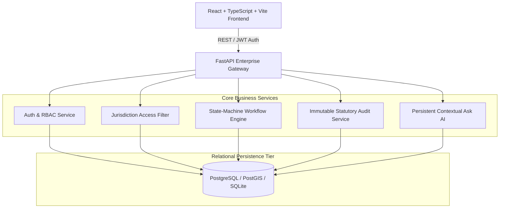

# TN-HDOS Target Architecture & Domain Specification

**Platform**: Tamil Nadu Highways Digital Operating System (TN-HDOS)  
**Classification**: Government Enterprise Mission-Critical System  
**Version**: 1.0.0 (Phase 0 & Phase 1 Foundation)  

---

## 1. Architectural Philosophy

TN-HDOS is designed as a **modular monolith** with clean bounded contexts, ensuring high cohesion and low coupling. Premature microservices have been avoided to preserve transactional integrity across projects, financial sanctions, and multi-agency dependencies.



---

## 2. Highway Classification & Design Palette (DESIGN.md)

| Road Classification | Hex Code | Tailwind Token | UI Role & Departmental Context |
| :--- | :--- | :--- | :--- |
| **State Highways (SH)** | `#006A4E` | `tnh-sh` | Primary brand color, main navigation, arterial corridors (e.g. SH-49 ECR) |
| **National Highways (NH)** | `#FFCC00` | `tnh-nh` | Central government assets, bypasses, GST corridor (e.g. NH-45) |
| **Major District Roads (MDR)** | `#004B87` | `tnh-mdr` | Regional connectivity, industrial corridors (e.g. MDR-102) |
| **Other District Roads (ODR)** | `#D1197E` | `tnh-odr` | Local hub linkages, taluk connectors (e.g. ODR-045) |
| **Rural & Village Roads** | `#FF6600` | `tnh-rural` | Panchayat roads, rural agrarian access (e.g. RUR-012) |

---

## 3. Departmental Navigation Structure (23 Connected Workspaces)

### Domain 1: Strategic Command (Apex Layer)
1. **CM Highways Smartboard** (`/cm-dashboard`) - CMO executive pulse, delivery index, and ministerial directives.
2. **Minister's Command Centre** (`/leadership/minister`) - Cabinet infrastructure dashboard, constituency queries, and press notes.
3. **Secretary's Command Centre** (`/leadership/secretary`) - Administrative sanctions, inter-departmental bottlenecks, and budget utilization.
4. **Organisation & Jurisdiction Intelligence** (`/organisation-intelligence`) - G.O. (Ms) No. 43 canonical organisation blueprint, 4 C&M Zones, 19 circles, 68 divisions, 285 subdivisions, and 19 historical redesignations.
5. **Executive Smartboard** (`/`) - Statewide portfolio KPIs, financial progress, and contractor ratings.
6. **Reports & Analytics** (`/reports`) - Statutory reports, legislative questions, and export consoles.

### Domain 2: Project Intelligence (Core Layer)
7. **Works Status Analytics** (`/works-analytics`) - Unified Works Data Explorer & Analytics Charts with URL-synchronized cascading filters.
8. **CRIDP Risk Intelligence** (`/cridp-risk-intelligence`) - 11-tab historical work investigation, root-cause analysis, and corrective actions.
9. **CRIDP Work Verification** (`/cridp-verification`) - 5-year road renewal verification, interval-union chainage overlap detection, and delegation of powers checks.
10. **Major Works ₹50 Cr+** (`/major-works`) - High-value project blocker tracking, loss prevention ledger, and pre-construction readiness gates.
11. **Project Portfolio Grid** (`/projects`) - Comprehensive master project directory with multi-field search and filters.
12. **Project 360° Dossier** (`/project-360`) - 16-facet connected digital passport for every highway and bridge asset.
13. **CKICP Intelligence** (`/ckicp`) - Asian Development Bank (ADB) funded industrial corridor monitoring.
14. **TNRSP-II Intelligence** (`/tnrsp`) - World Bank core road network closeout and PPP concession tracking.

### Domain 3: Engineering & Field Operations (Operational Layer)
15. **Field Operations** (`/field-ops`) - Daily site progress logs, labour turnout, and gang work maintenance.
16. **Engineering Quality** (`/quality`) - Highways Research Station (HRS) test registers, cube crushing strengths, and Non-Conformance Reports (NCR).
17. **Road & Bridge Assets** (`/assets`) - Road Asset Management System (RAMS) inventory, pavement condition index (PCI), and structural health monitoring.

### Domain 4: Commercial & Resource Management (Support Layer)
18. **Finance & Procurement** (`/finance`) - Letter of Credit (LC) tracking, IFMS integration, and contractor bill clearance.
19. **Contractor Intelligence** (`/contractors`) - Empanelled contractor performance ratings, live package commitments, and bid capacity validation.
20. **People & Directory** (`/directory`) - Official cadre registry, contact coordinates, and jurisdiction assignments.

### Domain 5: Governance & Inter-Agency Coordination (Control Layer)
21. **Department Connections** (`/departments`) - Inter-agency war room (Revenue, TANGEDCO, Forest, Southern Railway).
22. **Land & Utility Coordination** (`/land-utility`) - TN Highways Act 2001 Section 15(2) land parcels and utility shifting clearances.
23. **Leakage & Vigilance Intelligence** (`/leakage`) - Refinery bitumen reconciliation, weight bridge cross-audits, and anti-corruption alerts.

---

## 4. Organisation & Jurisdiction Architecture (G.O. Ms No. 43)

Governed by G.O. (Ms) No. 43, Highways and Minor Ports (HN1) Department, dated 13.03.2026:
- **Canonical Structure:** Department $\rightarrow$ Wing $\rightarrow$ Region $\rightarrow$ Circle $\rightarrow$ Division $\rightarrow$ Subdivision.
- **Construction & Maintenance (C&M) Scope:** 4 Regional Zones (Chennai, Trichy, Madurai, Coimbatore), 19 Circles, 68 Divisions, 285 Subdivisions, managing exactly **68,149.618 km** of SH, MDR, and ODR assets.
- **National Highways (NH) Wing Scope:** 4 Circles and 11 Divisions, isolated strictly from C&M road length and project metrics, marked `PENDING_VERIFICATION`.
- **Historical Continuity Engine:** 19 statutory Old-to-New division redesignations indexed in `HistoricalOrganisationMapping` to prevent historical data loss.
- **Data Quality Framework:** Automated mapping exception queue with Chief Engineer resolution workflows.

---

## 4. RBAC & Jurisdiction Security Matrix

```
                      ┌──────────────────────┐
                      │    Minister / Sec    │  Statewide Oversight
                      │    Chief Engineer    │
                      └──────────┬───────────┘
                                 │
                      ┌──────────▼───────────┐
                      │  Zonal Chief Eng     │  Zone Boundary (e.g. Chennai Zone)
                      └──────────┬───────────┘
                                 │
                      ┌──────────▼───────────┐
                      │ Superintending Eng   │  Circle Boundary (e.g. Chengalpattu Circle)
                      └──────────┬───────────┘
                                 │
                      ┌──────────▼───────────┐
                      │ Divisional Eng / EE  │  Division Boundary (e.g. Tambaram Division)
                      └──────────┬───────────┘
                                 │
                      ┌──────────▼───────────┐
                      │      Contractor      │  Strict Project Isolation (Own Contracts Only)
                      └──────────────────────┘
```

---

## 5. Persistent Ask AI Architecture

1. **Context Awareness**: Carries the active screen context (`currentModuleName`) and selected project record ID.
2. **Grounding References**: Extracts relevant pending clearances and milestone dates from the database to ground every response.
3. **Statutory Safety Boundary**: The AI assistant cannot automatically approve sanctions, disburse funds, or close official files.
4. **Transparent Disclaimers**: Prominently displays `[DEMO DATA ONLY]` tags to prevent conflating synthetic data with live departmental databases.

