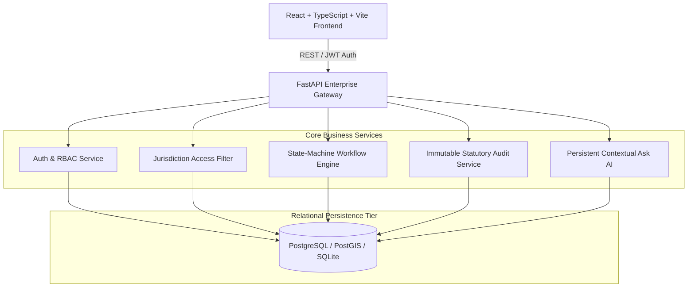

# TN-HDOS Target Architecture & Domain Specification

**Platform**: Tamil Nadu Highways Digital Operating System (TN-HDOS)  
**Classification**: Government Enterprise Mission-Critical System  
**Version**: 1.0.0 (Phase 0 & Phase 1 Foundation)  

---

## 1. Architectural Philosophy

TN-HDOS is designed as a **modular monolith** with clean bounded contexts, ensuring high cohesion and low coupling. Premature microservices have been avoided to preserve transactional integrity across projects, financial sanctions, and multi-agency dependencies.



---

## 2. Highway Classification & Design Palette (DESIGN.md)

| Road Classification | Hex Code | Tailwind Token | UI Role & Departmental Context |
| :--- | :--- | :--- | :--- |
| **State Highways (SH)** | `#006A4E` | `tnh-sh` | Primary brand color, main navigation, arterial corridors (e.g. SH-49 ECR) |
| **National Highways (NH)** | `#FFCC00` | `tnh-nh` | Central government assets, bypasses, GST corridor (e.g. NH-45) |
| **Major District Roads (MDR)** | `#004B87` | `tnh-mdr` | Regional connectivity, industrial corridors (e.g. MDR-102) |
| **Other District Roads (ODR)** | `#D1197E` | `tnh-odr` | Local hub linkages, taluk connectors (e.g. ODR-045) |
| **Rural & Village Roads** | `#FF6600` | `tnh-rural` | Panchayat roads, rural agrarian access (e.g. RUR-012) |

---

## 3. Departmental Navigation Structure (17 Modules)

1. **Executive Command Centre** (`/`) - Chief Minister, Minister, and Secretary strategic KPI cockpit.
2. **Leakage Intelligence** (`/leakage`) - Refinery bitumen reconciliation and anti-corruption signals.
3. **Project Management** (`/projects`) - DPR, technical sanctions, milestone schedules, and progress tracking.
4. **Project 360°** (`/project-360`) - Unified road stretch and bridge digital passport.
5. **People & Directory** (`/directory`) - Official hierarchy and contractor registers.
6. **Department Connections** (`/departments`) - Inter-agency war room (Revenue, TANGEDCO, TWAD, Forest, Railways).
7. **Engineering Quality** (`/quality`) - Highways Research Station (HRS) cube, core, and roughness tests.
8. **Finance & Procurement** (`/finance`) - Letter of Credit (LC), IFMS bridge, and bill clearance.
9. **Contractor Intelligence** (`/contractors`) - Empanelled contractor performance ratings and bid capacities.
10. **Field Operations** (`/field-ops`) - Daily field logs, gang work maintenance, and JE inspections.
11. **Road & Bridge Assets** (`/assets`) - RAMS asset register with condition scoring.
12. **Digital Office** (`/digital-office`) - E-Office files, G.O. repository, and statutory circulars.
13. **Land & Utility Coordination** (`/land-utility`) - TN Highways Act 2001 Section 15(2) and utility shifting.
14. **Legal, Audit & Compliance** (`/compliance`) - High Court writ petitions and AG audit paras.
15. **Citizen Services** (`/citizen-services`) - Pothole grievances and Right to Information (RTI).
16. **Reports and Analytics** (`/reports`) - Cabinet notes and Legislative Assembly Questions (LAQ).
17. **Administration** (`/admin`) - User provisioning, circle/division boundaries, and security audits.

---

## 4. RBAC & Jurisdiction Security Matrix

```
                      ┌──────────────────────┐
                      │    Minister / Sec    │  Statewide Oversight
                      │    Chief Engineer    │
                      └──────────┬───────────┘
                                 │
                      ┌──────────▼───────────┐
                      │  Zonal Chief Eng     │  Zone Boundary (e.g. Chennai Zone)
                      └──────────┬───────────┘
                                 │
                      ┌──────────▼───────────┐
                      │ Superintending Eng   │  Circle Boundary (e.g. Chengalpattu Circle)
                      └──────────┬───────────┘
                                 │
                      ┌──────────▼───────────┐
                      │ Divisional Eng / EE  │  Division Boundary (e.g. Tambaram Division)
                      └──────────┬───────────┘
                                 │
                      ┌──────────▼───────────┐
                      │      Contractor      │  Strict Project Isolation (Own Contracts Only)
                      └──────────────────────┘
```

---

## 5. Persistent Ask AI Architecture

1. **Context Awareness**: Carries the active screen context (`currentModuleName`) and selected project record ID.
2. **Grounding References**: Extracts relevant pending clearances and milestone dates from the database to ground every response.
3. **Statutory Safety Boundary**: The AI assistant cannot automatically approve sanctions, disburse funds, or close official files.
4. **Transparent Disclaimers**: Prominently displays `[DEMO DATA ONLY]` tags to prevent conflating synthetic data with live departmental databases.

