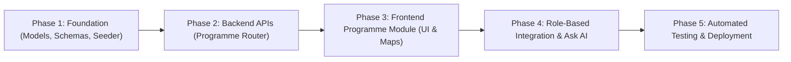

# CKICP & TNRSP-II Programme Intelligence Integration: Architectural Assessment & Master Plan

**System**: Tamil Nadu Highways Digital Operating System (TN-HDOS)  
**Programmes**:
1. **Chennai-Kanyakumari Industrial Corridor Project (CKICP)** (ADB Loan Assisted / East Coast Economic Corridor)
2. **Tamil Nadu Road Sector Project II (TNRSP-II)** (World Bank Loan Assisted)  
**Authoritative Portals**:
- CKICP: [https://www.ckicp.tn.gov.in/](https://www.ckicp.tn.gov.in/)
- TNRSP-II: [https://www.tnrsp.tn.gov.in/](https://www.tnrsp.tn.gov.in/)
- TN Highways: [https://www.tnhighways.tn.gov.in/](https://www.tnhighways.tn.gov.in/)
**Date**: November 2026  
**Status**: ARCHITECTURAL ASSESSMENT & STAGED IMPLEMENTATION PLAN

---

## 1. Current Architecture Assessment

The TN-HDOS platform consists of:
- **Backend Architecture**: FastAPI with Python 3.14+, SQLAlchemy ORM, SQLite/PostgreSQL compatibility, Alembic migrations ready, JWT bearer authentication with fine-grained RBAC and ABAC jurisdiction scoping (Statewide, Zone, Circle, Division, Contractor).
- **Frontend Architecture**: React 18, TypeScript, Vite, Tailwind CSS with official Tamil Nadu Highways brand styling (`#006A4E` Forest Green, `#004B87` Navy, `#D4AF37` Gold), Lucide icons, persistent Ask AI contextual floating dock, and hash routing for seamless GitHub Pages deployment.
- **Existing Leadership Workspaces**:
  - Minister's Command Centre (`/leadership/minister`): Strategic statewide capital delivery, district infrastructure matrix, ministerial directive dispatcher.
  - Secretary's Command Centre (`/leadership/secretary`): Departmental governance, zone and circle performance benchmarking, officer accountability alerts, disciplinary console.
  - Executive Smartboard Central Cockpit (`/`): 16 core KPIs, 9 deep-dive analytical sections.
  - Directory Page (`/directory`): 6-tab departmental directory covering 3-tier leadership, 4 regional zones, TN-HES cadres, and statutory committees.
  - Governance & Legal Registry (`/compliance`): Document registry (Policy Notes, G.O.s, SSR), statutory committee proceedings, threshold referrals (COT, TAC, 16(b)), and AI forensic findings validation.

---

## 2. Reusable Foundation Entities & Services

Existing entities in `backend/app/models.py` to be reused and extended:
1. `Project`: Retains primary engineering scheme attributes (cost, physical/financial progress, priority, dates).
2. `WorkPackage`: Represents civil work packages (e.g. EPC01, EPC02).
3. `Contract`: Connects awarded packages to contractors with agreement number, value, and validity.
4. `Contractor` & `Consultant`: Reuses empanelment, performance scoring, and blacklisting attributes.
5. `Official`, `Department`, `Zone`, `Circle`, `Division`: Reuses administrative and territorial hierarchy.
6. `DepartmentDependency`: Reuses external agency tracking (Revenue, TANGEDCO, Forest, TWAD, Railways).
7. `Issue`: Reuses issue escalation and workflow task dispatching.
8. `GovernmentDocumentRegistry`: Reuses official order and gazette document storage.
9. `AIIntelligenceFinding`: Reuses evidence grounding and human officer confirmation workflow.

---

## 3. Missing Modules & Database Entities

To accurately integrate CKICP and TNRSP-II without confusing programmes, projects, packages, tenders, and contracts, the following new relational entities are required:

| New Entity | Table Name | Purpose & Relationships |
| :--- | :--- | :--- |
| **`Programme`** | `programmes` | Master umbrella for special infrastructure programmes (`CKICP`, `TNRSP-II`, `CRIDP`, `TNRIDC`). Links to multiple `Project` records. |
| **`CorridorAlignment`** | `corridor_alignments` | Geographical corridor stretch with starting/ending nodes, districts traversed, length, and verified GeoJSON coordinates. |
| **`Tender`** | `tenders` | Distinct from contracts: captures procurement stages, publication date, bid submission deadlines, eligibility, estimated value, and status (e.g. Published, Technical Evaluation, Financial Opening, Awarded, Cancelled). |
| **`LandParcel`** | `land_parcels` | Granular cadastral tracking: district, taluk, village, survey numbers, private vs. govt land extent, Section 15(2) notification, Section 15(1) gazette, Section 19(1) award, compensation assessed vs. paid, possession status, and litigation flags. |
| **`LegalCase`** | `legal_cases` | High Court writ petitions, land acquisition enhancement appeals, and contractor arbitrations linked directly to projects, packages, and land parcels. |
| **`ProjectConsultant`** | `project_consultants` | Supervision consultants, Detailed Project Report (DPR) preparation consultants, and Independent Engineers. |

---

## 4. CKICP & TNRSP-II Source Data Inventory

### A. Chennai-Kanyakumari Industrial Corridor Project (CKICP)
- **Parent Corridor**: East Coast Economic Corridor (ECEC).
- **Financing**: Asian Development Bank (ADB) Loan Assistance & Government of Tamil Nadu counterpart funding.
- **Implementing Directorate**: Project Directorate, CKICP Complex, HRS Campus, Guindy, Chennai - 600 025.
- **Leadership**:
  - Project Director: Thiru D. Baskara Pandian, IAS (Full Additional Charge [`FAC`]).
  - Chief Engineer: Er. R. Vimala (Additional Charge [`A/C`]).
- **Key Official Tender Announcements (Published 18-02-2026)**:
  1. *CKICP Kancheepuram Tender Package 01* (`fnews_pdf50.pdf`): Widening and strengthening of road corridor in Kancheepuram circle; ADB financed.
  2. *CKICP Trichy Tender Packages 01 & 02* (`fnews_pdf53.pdf`): Two-lane with paved shoulder corridor upgrade in Tiruchirappalli division.
  3. *CKICP Kancheepuram Tender Package 03* (`fnews_pdf52.pdf`): Grade separator and drainage works along northern industrial corridor.
  4. *CKICP Kancheepuram Tender Package 02* (`fnews_pdf51.pdf`): Highway bypass and junction improvements in Kancheepuram taluk.

### B. Tamil Nadu Road Sector Project II (TNRSP-II)
- **Financing**: World Bank (International Bank for Reconstruction and Development).
- **Total Corridors Scope**: Approximately 1,187 km across Tamil Nadu.
- **Core Road Network (CRN) EPC Packages (EPC01 to EPC10)**:
  - Total length: **427.967 km**.
  - Total contract value: **₹1,704.91 Crore**.
  - Stretches: SH-116, SH-58, SH-04, SH-09, SH-70, SH-86, SH-79, SH-95, SH-89, SH-44, SH-41.
- **Public-Private Partnership (PPP) Packages**:
  - SH-15 (Gobi - Erode, 30.60 km) &rarr; Converted to EPC16 (₹272.53 Cr).
  - SH-37 (Oddanchatram - Dharapuram - Tiruppur, 70.20 km) &rarr; Active 8-year concessionaire maintenance.
  - SH-39 (Tirunelveli - Sengottai - Kollam, 45.64 km) &rarr; Converted and bifurcated into EPC14 (₹176.58 Cr) and EPC15 (₹254.13 Cr).
- **Output & Performance-Based Road Contracts (OPRC)**: 2 packages covering 581.493 km (₹220.07 Cr).
- **Additional Financing Works (EPC11 to EPC16)**: 107.379 km (₹1,047.72 Cr).
- **Land Acquisition Footprint**: **206.29 Hectares (2,062,934 sq.m)** across 16 packages.

---

## 5. Data Extraction & Provenance Plan

Every ingested record must carry mandatory verification metadata:
1. `source_url`: Official government portal URL.
2. `source_document`: Document filename / G.O. / Gazette reference.
3. `verification_status`:
   - `Verified`: Grounded in Gazette / G.O. / Official tender notice.
   - `Pending Verification`: Under review by engineering officers.
   - `Conflicting Source`: Detected discrepancy flagged with notes.
   - `Superseded`: Historical milestone or amended tender notice.
4. `confidence`: `HIGH`, `MEDIUM`, or `LOW`.

---

## 6. Sequential Implementation Plan

1. **Phase 1: Foundation & Data Architecture**:
   - Add `Programme`, `CorridorAlignment`, `Tender`, `LandParcel`, `LegalCase`, `ProjectConsultant` models to `backend/app/models.py`.
   - Update `backend/app/schemas.py`.
   - Create comprehensive seeder `backend/app/seed_ckicp_tnrsp.py` populating CKICP and TNRSP-II master records, packages, tenders, and land parcels.
2. **Phase 2: Backend REST Router**:
   - Create `backend/app/routers/programmes.py` with endpoints for programmes, tenders, land parcels, legal cases, and corridor intelligence.
   - Register router in `backend/app/main.py`.
3. **Phase 3: Frontend Programme Intelligence Page**:
   - Implement `frontend/src/pages/ProgrammeIntelligencePage.tsx` with dynamic programme selector (`CKICP` vs. `TNRSP-II`), interactive KPI headers, tender register with PDF links, land acquisition status breakdown, and litigation register.
   - Add routes in `frontend/src/App.tsx` and navigation items in `frontend/src/components/Sidebar.tsx`.
4. **Phase 4: AI & Role-Based Workspaces Integration**:
   - Provide role-specific drill-downs (Minister, Principal Secretary, Project Director, Chief Engineer, District Collector).
   - Equip Ask AI with grounding references for CKICP and TNRSP-II.
5. **Phase 5: Verification, Testing & Deployment**:
   - Add automated test cases in `backend/tests/test_ckicp_tnrsp.py`.
   - Run full test suite and build frontend.
   - Push to `origin main` for automated GitHub Pages deployment.

---

## 7. Risks and Mitigation

| Risk | Mitigation Strategy |
| :--- | :--- |
| **Conflation of Programme vs. Project vs. Package** | Strict relational hierarchy: 1 Programme &rarr; Many Projects &rarr; Many Packages &rarr; Many Tenders/Contracts. |
| **Fabrication of Missing Values** | Explicit `null` or `"Pending Verification"` badges for unannounced bidders or dates. |
| **Breaking Existing Routes** | Backward-compatible extensions: all existing Phase 1 & 2 routes (`/`, `/leadership/minister`, `/leadership/secretary`, `/projects`, `/directory`, `/compliance`) remain unaltered. |
| **Cost Inconsistency in Multi-Package Stretches** | Separate baseline sanctioned estimates from supplemental agreements and variation orders. |
