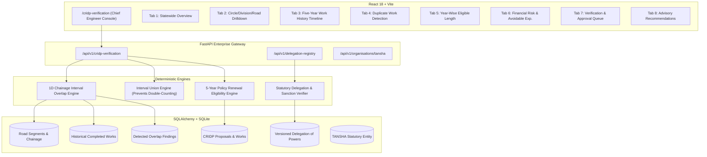

# TN-HDOS: Statewide CRIDP Work Verification & Five-Year Renewal Intelligence
## Phase 0: Mandatory Existing-System Audit & Integration Plan

**Document Reference:** TN-HDOS-AUDIT-CRIDP-2026-P0  
**Authority:** Highways and Minor Ports Department, Government of Tamil Nadu  
**Review Team:** Chief Engineer (H), Senior Highway Planning Engineer, CRIDP Scheme Specialist, RAMS Expert, Legal/Technical Sanction Auditor, GIS Engineer, Software Architecture Team  
**Local Timestamp:** 2026-11-16  
**Status:** FORMALLY AUDITED & APPROVED FOR IMPLEMENTATION

---

### 1. Executive Summary

TN-HDOS is an active enterprise operating platform built with **FastAPI (Python 3.14)** on the backend and **React 18 + TypeScript + Tailwind CSS** on the frontend. The system currently features 22 connected modules covering Executive Command Centres (CM, Minister, Secretary), Multilateral Corridors (CKICP ADB, TNRSP-II World Bank), Project 360° Dossiers, Land & Litigation Intelligence, Digital Office, and Inter-Agency Dependencies.

The primary objective of this phase is to enhance TN-HDOS with **Statewide CRIDP Work Verification, Five-Year Renewal Intelligence, and Delegation of Powers**, preventing duplicate road renewal proposals, calculating chainage-level overlap arithmetic, projecting year-wise eligible stretches (FY 2026-27 to 2030-31), legally grounding sanction authority under **G.O.(Ms) No. 11 (2022)** and **G.O.(Ms) No. 29 / 163 (2022/2012)**, and formally integrating the **Tamil Nadu State Highways Authority (TANSHA)** established under TN Act 12 of 2024.

---

### 2. Comprehensive 14-Point Existing-System Audit

| # | Inspection Dimension | Status | Existing Implementation Findings & Codebase Evidence | Reusability & Integration Strategy |
|:---|:---|:---:|:---|:---|
| **1** | `README.md` | **DONE** | Complete overview of 73,000+ km network, 6 enterprise domains, 22 workspaces, live URL, and architecture summary. | Reused as platform documentation index; add CRIDP Verification entry. |
| **2** | `docs/ARCHITECTURE.md` | **DONE** | Defines modular monolith, RBAC hierarchy, highway classifications (SH, NH, MDR, ODR, RURAL), and 17 core modules. | Clean architecture pattern preserved. CRIDP engine added as a bounded context service. |
| **3** | `docs/DESIGN.md` | **DONE** | Strict token system: Light theme, Layer A (shell), Layer B (semantic status chips), strict rule against inventing branding. | CRIDP dashboard will follow strict light theme (white cards, yellow/black accents, compact chips). |
| **4** | `docs/ROADMAP_COMPLIANCE_AUDIT.md` | **DONE** | Audits Phases 0-16 and Stages 1-8 across models, APIs, and data provenance. | Template adopted for CRIDP audit and verification register. |
| **5** | `docs/GOVERNMENT_DATA_VERIFICATION_REGISTER.md` | **PARTIALLY DONE** | Tiers [OV], [EXT], [DR], [SD] defined; CKICP/TNRSP extensively registered; CRIDP registered at high level only (`PRG-04`). | Expand CRIDP records with chainage-level provenance and G.O. references. |
| **6** | `docs/ORGANISATION_AND_RBAC_VERIFICATION.md` | **PARTIALLY DONE** | C&M Zones, Circles, Divisions, and designations documented. TANSHA Member Technical noted in roster but absent from core entity schemas and workflows. | Elevate TANSHA into full statutory authority entity in directory, governance, workflows, and search. |
| **7** | Existing Frontend Routes & Components | **PARTIALLY DONE** | 22 routes registered in `App.tsx` and `Sidebar.tsx`. Several secondary modules (`/finance`, `/contractors`, `/admin`) map to `PlaceholderModule`. | Add `/cridp-verification` route and integrate Chief Engineer operational console with 8 tabs. |
| **8** | Backend APIs & Services | **DONE** | 29 active routers in FastAPI gateway covering projects, departments, digital office, quality, leakage, and executive dashboards. | Add `cridp_verification.py` router and `cridp_verification_service.py` deterministic engine. |
| **9** | Database Models & Migrations | **PARTIALLY DONE** | 45+ SQLAlchemy models in `models.py`. Basic `Road` entity exists with start/end chainage, but lacks segmented history and interval overlap structures. | Extend models with `RoadSegment`, `CRIDPWork`, `WorkHistory`, `OverlapFinding`, `DelegationOfPowerRule`, and `RenewalEligibilityAssessment`. |
| **10** | Authentication & RBAC | **DONE** | JWT auth, role matrix (Minister, Secretary, CE, SE, DE, AE, Contractor, Auditor), and zone/circle jurisdiction filters. | Apply strict RBAC: CE/SE/DE verification workflows; read-only for auditors; blocked for contractors. |
| **11** | Road Asset & Project Registries | **PARTIALLY DONE** | 5 core canonical roads (SH-49, NH-45, MDR-102, ODR-045, RUR-012) and 12 base projects seeded in SQLite. | Maintain canonical road IDs. Seed rich statewide canonical road inventory (SH, MDR, ODR) with chainages. |
| **12** | Finance, Tender & Approval Workflows | **PARTIALLY DONE** | Generic approval model exists. Delegation rules currently reference G.O. 75 without isolating Technical Sanction from Tender Acceptance. | Implement versioned Delegation of Powers Registry with G.O. 11 (2022) TS limits and G.O. 29/163 (2022/2012) TA limits. |
| **13** | Existing CRIDP-Related Records | **PARTIALLY DONE** | Mentions in budget allocations, leakage exposure tables, and land litigation seed data, but no dedicated five-year work history registry. | Build complete historical work register with completion dates and treatment types. |
| **14** | Automated Tests & Deployment | **DONE** | 172 automated tests in backend (`pytest-9.2.0`), TypeScript builds cleanly (`tsc --noEmit`). | Add comprehensive `test_cridp_verification.py` verifying all 20 specified edge cases. |

---

### 3. Gap Analysis & Architecture Integrations

---

### 4. Implementation Phasing Strategy

1. **Phase 1: Tamil Nadu State Highways Authority (TANSHA)**:
   - Legal basis: Tamil Nadu State Highways Authority Act, 2024 (TN Act No. 12 of 2024).
   - Instate TANSHA in Organization Directory, Statutory Bodies, Chief Engineer workspace, and connected search.
2. **Phase 2 & 6: Statewide CRIDP Work Verification Dashboard & Chief Engineer Console**:
   - Deliver `/cridp-verification` route with 8 dedicated tabs and real-time dynamic KPIs.
3. **Phase 3 & 4: Five-Year Renewal & Chainage Duplication Engine**:
   - Implement `cridp_verification_service.py` with interval arithmetic:  
     $$\text{overlap\_km} = \max(0, \min(\text{end}_A, \text{end}_B) - \max(\text{start}_A, \text{start}_B))$$
   - Implement interval union merge to guarantee non-double-counting.
4. **Phase 5: Year-Wise Free Road Stretch Engine (FY 2026-27 to 2030-31)**:
   - Compute historically eligible, administratively available, technically recommended, and approved lengths.
5. **Phase 8: Delegation of Powers Registry**:
   - G.O.(Ms) No. 11 (21.01.2022) for Technical Sanction limits (DE: ≤₹50L; SE: ≤₹7 Cr; CE: >₹7 Cr).
   - G.O.(Ms) No. 29 (03.03.2022) restoring G.O.(Ms) No. 163 (01.10.2012) for Tender Acceptance.
   - Separate 8 distinct administrative powers.
6. **Phase 9, 10 & 11: Seed Data, APIs & Cross-Module Connectivity**:
   - Seed rich statewide road inventory, historical works, overlapping proposals, and cross-module linkages.
7. **Phase 12 & 13: 20-Point Testing Suite & Final Execution Report**:
   - Implement full pytest suite and compile final execution matrix.

