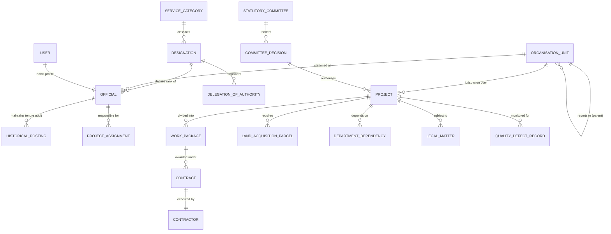

# Tamil Nadu Highways Department: Data Model & Entity Relationship Architecture

**Document Reference**: TN-HDOS-DATA-01  
**Database Technology**: Relational (PostgreSQL / SQLite Production Compatible)  
**ORM Framework**: SQLAlchemy (Python) & Pydantic V2  
**Status**: APPROVED SCHEMA BLUEPRINT

---

## 1. Existing vs. Proposed Schema Mapping

| Entity Group | Current Implemented Model | Extended Architecture for Phase 3/4 | Purpose & Governance Enhancement |
| :--- | :--- | :--- | :--- |
| **Cadres & Designations** | `ServiceCategory`, `Designation` | Add `CadreRecruitmentRule`, `ProbationCondition` | Encodes exact TNPSC entry quota (3:1 Degree to Diploma) and promotion eligibility rules under G.O.Ms.No.172. |
| **Hierarchy & Units** | `Department`, `Zone`, `Circle`, `Division`, `Subdivision` | Add `OrganisationUnit` with `parent_unit_id`, `effective_from`, `effective_to` | Enables dynamic historical reorganisation modeling without changing database schema when circles/divisions move under G.O.Ms.No.43. |
| **People & Postings** | `User`, `Official`, `HistoricalPosting` | Add `UserAssignment`, `AdditionalChargeRecord` | Formally separates substantive posts from `A/C` and `FAC` acting charges, preventing historical accountability overwrites. |
| **Committees & Approvals** | `StatutoryCommittee`, `DelegationOfAuthority`, `LeadershipDecision` | Add `CommitteeMeeting`, `CommitteeDecision`, `StatutoryReferral` | Triggers automated referral dossiers to Commissionerate of Tenders (COT), TAC, or RASC when financial/technical limits are breached. |
| **Infrastructure Assets** | `Road`, `Bridge`, `Project`, `WorkPackage` | Add `LinearSection`, `AssetPassport`, `ChainageAnomaly` | Handles bidirectional and decreasing chainage (e.g. NH-42) and multi-division corridor splits (e.g. NH-181). |
| **Land Acquisition** | `LeadershipIssue` (LA category), `DepartmentDependency` | Add `LandAcquisitionParcel`, `SectionNoticeRecord` | Tracks parcel-level survey numbers, Sec 15(2) notices, Sec 15(1) gazettes, Sec 19(1) awards, and solatium payments. |
| **External Stakeholders** | `DepartmentDependency`, `InterdepartmentalBlocker` | Add `ExternalDepartmentSPOC`, `ClearanceSubmission` | Tracks lead time, statutory escalation paths to Collectors / Secretariat, and lead time variance. |

---

## 2. Entity Relationship Diagram (Mermaid)

---

## 3. Data Dictionary Key Attributes

1. **`HistoricalPosting`**:
   - `id`: Integer Primary Key
   - `official_id`: ForeignKey to `Official.id`
   - `designation_title`: String(150) (e.g. "Divisional Engineer (H), Tambaram Division")
   - `posting_unit`: String(200) (e.g. "Tambaram Division, Chengalpattu Circle")
   - `posting_type`: Enum (`REGULAR`, `ADDITIONAL_CHARGE`, `FULL_ADDITIONAL_CHARGE`, `DEPUTATION`)
   - `from_date`: DateTime
   - `to_date`: DateTime (Nullable, null indicates active posting)
   - `is_current`: Boolean
   - `transfer_go_reference`: String(150) (e.g. "G.O.(Rt) No. 201, Highways, dated 28.10.2023")
2. **`StatutoryCommittee`**:
   - `id`: Integer Primary Key
   - `code`: String(50) Unique (`BOE`, `TAC`, `RASC`, `RASC_LA`, `COT`, `SSR`, `HLDRC`, `EXPERT_16B`)
   - `name`: String(200)
   - `chairperson_title`: String(150)
   - `mandate_summary`: Text
   - `constitution_go`: String(150)
3. **`DelegationOfAuthority`**:
   - `id`: Integer Primary Key
   - `designation_code`: String(50)
   - `power_type`: String(100) (`TECHNICAL_SANCTION`, `TENDER_ACCEPTANCE`)
   - `monetary_limit_cr`: Float
   - `tender_excess_pct_limit`: Float
   - `statutory_rule_reference`: String(200)
