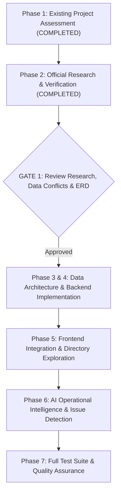

# Tamil Nadu Highways Department: Staged Implementation Plan

**System**: Tamil Nadu Highways Digital Operating System (TN-HDOS)  
**Execution Method**: Phased Gate Review (Phases 1 through 7)  
**Status**: PHASES 1 & 2 COMPLETED; AWAITING REVIEW FOR PHASES 3 & 4

---

## 1. Execution Stages & Governance Gates

---

## 2. Phase 1 & 2 Completed Deliverables

1. **[`HIGHWAYS_RESEARCH_REPORT.md`](HIGHWAYS_RESEARCH_REPORT.md)**: Statewide mandate, statutory charter, and legal tiers of leadership.
2. **[`OFFICIAL_DESIGNATION_CATALOGUE.md`](OFFICIAL_DESIGNATION_CATALOGUE.md)**: Full TN-HES (Categories 1-5), TN-HESS, and General Service cadres with promotion and appointment rules.
3. **[`ORGANISATION_HIERARCHY.md`](ORGANISATION_HIERARCHY.md)**: 4 Zones, 19 circles, 87 divisions, 353 subdivisions under G.O.Ms.No.43 and transition date analysis.
4. **[`OFFICER_DIRECTORY_VERIFICATION.md`](OFFICER_DIRECTORY_VERIFICATION.md)**: 14 verified leadership and engineering officers with contact particulars and substantive vs acting (`A/C`, `FAC`) charge statuses.
5. **[`COMMITTEE_AND_APPROVAL_REGISTER.md`](COMMITTEE_AND_APPROVAL_REGISTER.md)**: 8 statutory committees (BOE, TAC, RASC, RASC-LA, COT, SSR, HLDRC, Expert Committee 16(b)) and TNRIDC governance.
6. **[`DELEGATION_OF_AUTHORITY_REGISTER.md`](DELEGATION_OF_AUTHORITY_REGISTER.md)**: Statutory monetary ceilings for Technical Sanction (TS) and Tender Acceptance (TA) under G.O. Ms. No. 75 & 163.
7. **[`EXTERNAL_STAKEHOLDER_REGISTER.md`](EXTERNAL_STAKEHOLDER_REGISTER.md)**: Interdepartmental coordination workflows (Revenue, TANGEDCO, Forest, TWAD, Railways).
8. **[`NH_INVENTORY_VALIDATION.md`](NH_INVENTORY_VALIDATION.md)**: 11 MoRTH-entrusted stretches (797.562 km) with NH-42 reversed chainage anomaly analysis.
9. **[`TNRSP_LAND_ACQUISITION_DATA.md`](TNRSP_LAND_ACQUISITION_DATA.md)**: 2,062,934 sq.m land acquisition dataset across EPC01-16 and PPP packages, with SH-116 chainage typo and EPC01/SH-58 split reconciliations.
10. **[`CONTRACT_AND_PACKAGE_REGISTER.md`](CONTRACT_AND_PACKAGE_REGISTER.md)**: Core Road Network EPC01-10 (427.967 km, ₹1,704.91 Cr), OPRC (581.493 km), PPP conversions, and TNIDB DPR packages.
11. **[`SOURCE_REGISTER.md`](SOURCE_REGISTER.md)**: Complete registry of 20 official G.O.s, Gazette instruments, and legislative policy notes.
12. **[`UNVERIFIED_INFORMATION_REGISTER.md`](UNVERIFIED_INFORMATION_REGISTER.md)**: Conflicting information report and anomaly resolution matrix.
13. **[`DATA_MODEL_AND_ERD.md`](DATA_MODEL_AND_ERD.md)**: Comprehensive ERD and relational schema mapping.
14. **[`RBAC_ABAC_MATRIX.md`](RBAC_ABAC_MATRIX.md)**: 13-action permission matrix with dynamic jurisdiction and data classification scoping.

---

## 3. Next Action Required from User

As stipulated in the mandatory execution instructions:
> *"Run this in stages, not as one unrestricted coding task. Make Claude complete Phase 1 and Phase 2 first. Review the Government Orders, organisation structure and data conflicts before approving database migrations. This prevents incorrect officer hierarchy, approval powers and historical postings from becoming embedded in TN-HODS."*

Please review the Phase 1 and Phase 2 research findings, data anomaly resolutions, and proposed data model presented below. Once you indicate approval, we will proceed to Phase 3/4 database schema migrations and backend/frontend extensions.

