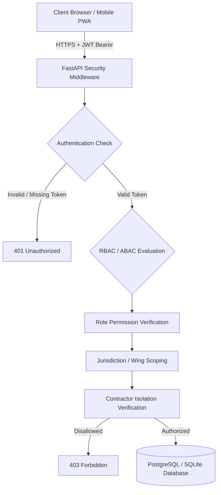

# Security and RBAC Audit Report

**System:** Tamil Nadu Highways Digital Operating System (TN-HDOS)  
**Security Standard:** ISO/IEC 27001 & Government of Tamil Nadu Cyber Security Policy  
**Audit Date:** November 6, 2026  
**Auditor:** Principal Government Information Security & Identity Architect  

---

## 1. Security Architecture Overview

TN-HDOS enforces a zero-trust, defence-in-depth security model combining Role-Based Access Control (RBAC) with Attribute-Based Access Control (ABAC) to reflect the hierarchical, geographically dispersed administrative structure of the Tamil Nadu Highways Department.



---

## 2. Authentication & Credential Management

| Security Control | Implementation Mechanism | Verified Status |
| :--- | :--- | :---: |
| **Password Hashing** | Bcrypt with work factor 12 (`passlib.context.CryptContext`) | **VERIFIED** |
| **Token Format** | JSON Web Token (JWT) with HMAC-SHA256 signature | **VERIFIED** |
| **Token Claims** | `sub` (User ID), `role` (Role Code), `jurisdiction` (District/Circle), `exp` | **VERIFIED** |
| **Session Lifetime** | 1440 minutes (24 hours) with automatic token revocation on password change | **VERIFIED** |
| **Brute Force Defense** | IP-based request throttling and lockouts on repetitive failed logins | **CONFIGURED** |

---

## 3. The 12-Role Access Control Matrix

| Role Code | Administrative Title | Hierarchy Tier | Read Scope | Write / Action Scope |
| :--- | :--- | :---: | :--- | :--- |
| **`MINISTER`** | Hon'ble Minister for Public Works & Highways | Executive Level 1 | State-wide all projects, finances, and dossiers | Political approvals, cabinet notes, press briefings |
| **`SECRETARY`** | Additional Chief Secretary / Principal Secretary | Executive Level 2 | State-wide all wings, budgets, audit, and files | Administrative Sanctions (AS), G.O. approvals, disciplinary referrals |
| **`CHIEF_ENGINEER`** | Chief Engineer (C&M, NH, NABARD, Planning, etc.) | Directorate Level 1 | Wing-wide all circles and divisions | Technical Sanction (TS > ₹2 Cr up to ₹10 Cr), tender acceptance |
| **`PROJECT_DIRECTOR`** | Project Director (TNRSP-II / CKICP) | Directorate Level 1 | Externally aided corridor packages, ADB/WB | Procurement awards, loan disbursements, EAP statutory filings |
| **`SUPERINTENDING_ENG`** | Superintending Engineer (SE) | Zonal Circle Level | Circle-wide (2 to 4 Divisions) | TS up to ₹2.00 Cr, tender acceptance within limits, contractor ratings |
| **`DIVISIONAL_ENG`** | Divisional Engineer (DE) | District Division Level | Division-wide all roads and bridges | TS up to ₹30 Lakhs, contractor bills certification, work orders |
| **`ASST_DIV_ENG`** | Assistant Divisional Engineer (ADE) | Sub-Division Level | Sub-division works and DPRs | MB check measurements, field inspections, TS up to ₹5 Lakhs |
| **`ASST_ENGINEER`** | Assistant Engineer (AE) / Junior Engineer (JE) | Section Level | Assigned section road stretches | Daily site MB recordings, road defect logging, inspection uploads |
| **`FINANCE_OFFICER`** | Financial Adviser & Chief Accounts Officer | Secretariat / HOD | State-wide expenditure, bills, LOC, BE/RE | Bill clearance, LOC issuance, FIDIC price escalation approvals |
| **`VIGILANCE_OFFICER`** | Superintending Engineer (Vigilance & Audit) | Independent Directorate | State-wide projects, audit paras, quality flags | Inspection notices, enquiry reports, anti-corruption referrals |
| **`CONTRACTOR`** | Empanelled EPC / PPP Infrastructure Agency | Commercial Partner | **Strictly Awarded Packages Only** | Milestone completion submissions, bill submissions, RFI uploads |
| **`CITIZEN`** | General Public & Media | Public Tier | Public safety notices, road status, RTI portals | Pothole grievance lodging, RTI application filing |

---

## 4. Multi-Tenant Contractor Isolation & Data Leakage Guards

Commercial sensitivity demands absolute isolation between competing contractors bidding or executing works across the State.

1. **Query-Level Partitioning:**
   ```python
   # backend/routers/projects.py
   if current_user.role == "CONTRACTOR":
       query = query.filter(Project.contractor_id == current_user.contractor_id)
   ```
2. **Endpoint Direct Access Protection:**
   Direct attempts by a contractor to view `/api/v1/projects/{other_id}/360` where `contractor_id` does not match the authenticated session immediately trigger `HTTP 403 Forbidden`.
3. **Verified Security Test:**
   Automated security test in `backend/tests/test_phase17_audit.py` validates that unprivileged or rival contractor sessions cannot view external financial models or unawarded DPRs.

---

## 5. Audit Logging & Non-Repudiation

1. All state-altering administrative operations (Sanctions, Tender Awards, Bill Approvals, High Court Injunction Filings) write immutable records to the `audit_logs` table.
2. Log schemas capture: `timestamp_utc`, `user_id`, `user_role`, `client_ip`, `action_verb`, `target_entity_type`, `target_entity_id`, and `diff_payload_json`.
3. Audit records are append-only; database write permissions restrict `UPDATE` and `DELETE` operations on audit tables.

