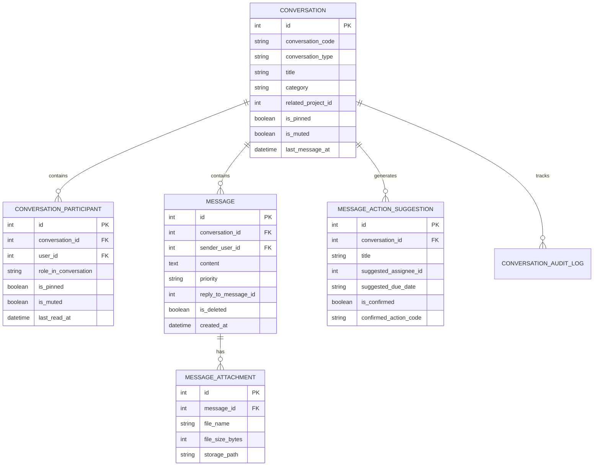

# TN-HDOS One-to-One Messaging, Group Chat and Unified Discussion Architecture

## 1. Architectural Philosophy

The Tamil Nadu Highways Department Operations System (TN-HDOS) requires an integrated, secure, and auditable official messaging mechanism. Standard public instant messengers (such as WhatsApp or Telegram) lack government record linkage, tamper-evident audit logging, statutory access controls, and direct binding to engineering project artifacts (e.g. EPC packages, court stay orders, utility clearances, and contractor bills).

The TN-HDOS Messaging Module delivers an enterprise-grade discussion grid structured across three distinct operational layers:
1. **Compact Unified Header Integration**: Instant icon-driven reachability with unread notification counter badges and accessible tooltips.
2. **Dedicated Tri-Pane Workspace (`#/messages`)**: High-throughput desktop and mobile-responsive discussion terminal designed for rapid triage, evidence attachment, and official directive issuance.
3. **AI Decision Intelligence Engine**: Continuous context extraction delivering executive summaries, unresolved bottleneck alerts, and actionable directives with mandatory human confirmation.

---

## 2. Component Layout & Workspace Ergonomics

### 2.1 Compact Top Application Header
The global application header maintains strict icon consistency and visual hierarchy:
- **Order of Action Controls**:
  1. `Global Search` (Inline input on desktop, trigger modal on mobile)
  2. `Notifications` (`Bell` with unread badge e.g. `3`)
  3. `Calendar & Deadlines` (`Calendar` icon linking to `#/calendar`)
  4. `Messages & Discussions` (`MessageSquare` with live unread badge e.g. `4` or `99+`)
  5. `Help & SOP` (`HelpCircle` icon invoking official standard operating procedures)
  6. `Theme Customizer` (`Palette` icon with GIGW Navy / Classic Tamil Nadu color selection)
  7. `Profile & Identity` (Avatar ring with RBAC Persona switcher)
- **Ergonomic Standards**:
  - Uniform `36x36px` (`w-9 h-9`) button footprint with `rounded-lg` borders.
  - Hover and focus-within tooltips (`role="tooltip"` and `aria-label`) on all icon triggers.
  - Numeric badge capping: values exceeding 99 render as `99+`.

### 2.2 Tri-Pane Discussion Terminal (`#/messages`)
- **Left Panel (Conversation Navigation)**:
  - Global query filtering across conversation codes, titles, and project identifiers.
  - Category tabs: `All`, `Direct`, `Groups`, `Projects`, `Unread`, and `Pinned`.
  - Pinned conversation pinning with priority visual markers.
  - "New Direct Message" directory picker and "New Working Group" modal launchers.
- **Centre Panel (Active Operational Thread)**:
  - Header showcasing active title, category pill, participant count, and quick jump to `Project 360°`.
  - Message thread with date breaks, role badges (`Minister`, `Secretary`, `Chief Engineer`, `Contractor`), and priority alerts (`CRITICAL`, `HIGH`, `ROUTINE`).
  - Quoted message replies, file attachment badges with download links, and timestamp tracking.
  - Message composer equipped with priority selectors, attachment upload metadata, and multiline text input.
- **Right Panel (Collapsible Context & AI Intelligence)**:
  - **AI Executive Summary Card**: Automatically computed summary of key decisions and unresolved risk items.
  - **AI Action Directive Extractor**: Identification of actionable commitments with assignee suggestions and due dates, backed by an explicit "Confirm Directive" workflow.
  - **Highway Asset Linkage**: Project code, package name, and direct routing to Project 360° profile.
  - **Official Roster**: Full listing of verified participants, designation titles, and conversation roles.

---

## 3. Database Schema Overview

