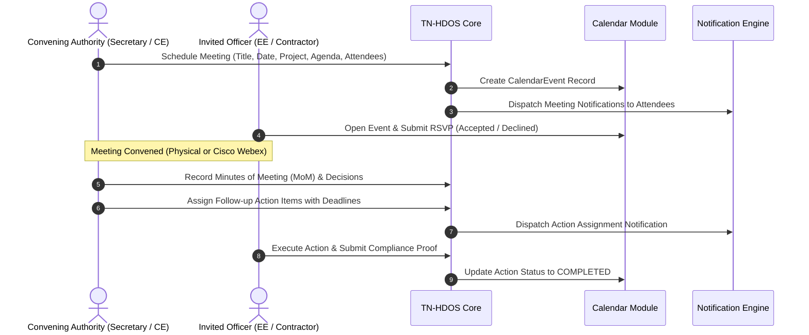

# TN-HDOS Meeting Management & Decision Lifecycle

## 1. End-to-End Workflow Diagram

---

## 2. Core Functional Requirements

### 2.1 Pre-Meeting Workflow
- **Agenda & Preparation Notes**: Organiser specifies formal agenda items, required document attachments (GAD drawings, soil logs, progress sheets), and previous meeting references.
- **Participant Invitation & RSVP**: Attendees can formally accept, decline, or mark tentative with explanatory notes.
- **Project & Department Linking**: Every meeting is explicitly linked to its parent corridor or scheme.

### 2.2 Post-Meeting Workflow
- **Official MoM Recording**: Formal record of discussions, observations, objections, and consensus.
- **Decisions Summary**: High-level ministerial or secretarial orders resulting from the session.
- **Action Item Tracking**:
  - Each decision can spawn one or more assigned action items (`ACT-EVT-0001-01`).
  - Action items mandate: assigned officer, responsible department, priority tier, and SLA due date.
  - Generates automatic alert in the assignee's Notification Centre and Calendar.
- **Automated SLA Escalation**: If an assigned meeting action item is overdue by $>3$ days, an automated escalation alert is dispatched to the reporting Chief Engineer or Principal Secretary.

